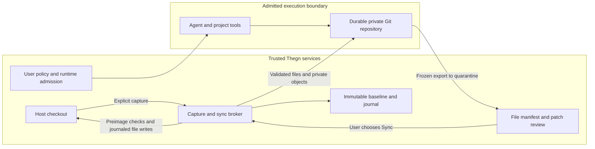

# Durable private workspaces and enforceable sandbox policy

Date: 2026-10-13. Status: proposed architecture, for implementation decision.
This audit milestone adds documentation and disposable evidence fixtures only.
The configuration names and interfaces below do not exist yet.

## Recommended decision

Make Thegn own durable workspace identity, capture, review, explicit sync, and
recovery. Put execution behind a runtime adapter that must prove it can enforce
the entire effective policy before a workload starts. Prefer an OpenShell
adapter for destination-controlled networking after qualification; retain
Thegn's native backends for offline execution and deliberately selected legacy
workflows. Do not make workspace durability depend on a container's writable
layer or a successful export during shutdown.

The target default is **private copy + private home + offline + fail closed**.
An agent that needs a model API chooses a user-owned agent network preset and a
scoped account before starting. Installed tools and dependencies can be prepared
in reviewed images or downloaded through separately granted destinations.
An execution environment name, container availability, and an isolation-class
label are insufficient proof of these controls.

The broker never imports sandbox Git refs/config/hooks into the host checkout.
The diagram shows the proposed custody model; no such broker is implemented yet.

## Compare the implementation directions

| Direction                             | Fit                                                                                                                                               | Cost and remaining work                                                                                                                                                                                                                       | Decision                                                                                             |
| ------------------------------------- | ------------------------------------------------------------------------------------------------------------------------------------------------- | --------------------------------------------------------------------------------------------------------------------------------------------------------------------------------------------------------------------------------------------- | ---------------------------------------------------------------------------------------------------- |
| Harden existing backends              | Preserves existing panes, host toolchains, placement and installation footprint. Native bwrap and OCI can support offline private-copy execution. | Thegn must implement packet enforcement/proxy mediation, policy lifecycle, per-workspace state, backend admission, credential scoping and reliable audit; reconcile every launcher. Systemd, WSL and Windows cannot be treated as equivalent. | Necessary immediate repairs and offline option; do not build another DNS-based destination boundary. |
| Use OpenShell as the policy runtime   | A documented connection boundary, filesystem policy, provider mediation and runtime lifecycle reduce Thegn's enforcement responsibilities.        | Adds a gateway, supported Linux guest/kernel requirements, versioned protocol and deployment concerns. Transfer semantics do not provide Thegn's patch review, conflicts or transactional sync.                                               | Candidate runtime, subject to local conformance and persistence tests.                               |
| External runtime + Thegn workspace/UI | Thegn keeps durable private Git state and consistent user behavior while delegating enforcement through a measured adapter.                       | Needs a precise adapter contract and durable storage admission. Thegn still owns all host command/trust paths and the transfer attack surface.                                                                                                | **Recommended target**, with native offline adapters and explicit weaker modes.                      |

The current external-runtime comparison, version constraints and citations are
in [external-runtime-fit.md](external-runtime-fit.md). OpenShell has not been
installed or qualified by this audit. MXC's old README preview warning is absent
from the current main revision checked here; that change permits renewed
evaluation, but does not establish a tested security boundary for Thegn.

## Three independent workspace choices

| Proposed `workspace.mode`                       | Files and Git identity                                                                               | User behavior and exposure                                                                                                               |
| ----------------------------------------------- | ---------------------------------------------------------------------------------------------------- | ---------------------------------------------------------------------------------------------------------------------------------------- |
| `private-copy` (default for new untrusted work) | Durable independent Git repository and file tree. No source checkout or source Git metadata mounted. | Changes stay private until explicit review and sync. Sandbox commits/refs never land on the host.                                        |
| `git-worktree`                                  | A separate linked Git worktree; source repository common Git metadata remains shared.                | File edits stay in that worktree, but refs, objects, hooks and other common metadata can affect sibling work. Lower integrity isolation. |
| `live-mount`                                    | Existing selected host tree mounted at its actual path, with existing common Git mounts.             | Edits immediately affect host files. Lower filesystem isolation; no explicit-sync guarantee.                                             |

Workspace mode and execution backend are separate decisions. A private copy
run as a host process still lacks confinement. A container running a live mount
still writes host files. Each launch displays workspace mode, actual boundary,
home exposure, shared writable mounts and effective egress independently.
Changing mode creates a new workspace generation; it does not silently alter a
running pane or delete the previous copy.

## Private-copy ownership and initial capture

Allocate a random workspace UUID under a private durable data root, scoped by
user and repository identity. Split storage into the runtime-writable repository
and broker-owned metadata: baseline manifests and blobs, transaction journals,
review artifacts, lease records and audit receipts. Mount only the repository
into the workload. Do not mount the parent directory, host checkout, application
state, control sockets, source common Git directory or neighboring copies.
Local permission bits alone do not protect broker metadata from an unrestricted
same-UID host process; admission must supply the filesystem boundary. Stronger
same-user threat models need a separate broker identity or VM.

Initial capture is an explicit snapshot of the selected host worktree, including
its dirty tracked files, staged/unstaged file content as currently visible, and
nonignored untracked files. The host index is recorded for conflict diagnostics
but remains unchanged. Do not accidentally clone only HEAD and lose existing
work. A short application-owned Git mutation lock helps Thegn operations, but
does not stop editors or external Git. Capture reads must verify identity and
content twice or use a filesystem snapshot; changed input aborts/retries rather
than declaring a coherent baseline.

Treat source Git configuration as executable input too: capture and history
transport must disable fsmonitor, hooks, filters, external diff and credential
helpers, use a broker-owned Git configuration, and confine parser operations.
Never run an ordinary host checkout/filter just to construct the private copy.

Create a new Git repository in the private tree. Import only the chosen base
commit and explicitly selected reachable history through an object transport or
bundle into newly owned objects. A reviewed history-free initial commit is an
alternative when historical contents should not be exposed. Never copy the
linked `.git` pointer, `commondir`, source `config`, hooks, remotes, credentials,
worktree registrations, index, `objects/info/alternates` or unrelated refs.
Never use shared-object cloning or hardlinks; reflinks are acceptable only with
filesystem-guaranteed independent writes. Remove source remotes and configure a
minimal private identity, no push URL and empty hooks directory. Overlay the
captured files and retain an immutable file baseline outside the workload.

Before admission, verify `.git` is a real private directory; Git's common dir,
object directory and refs resolve inside it; there are no external alternates,
symlinked metadata or shared object inodes. Repeat confinement checks at reuse.
Historical blobs can themselves contain secrets; selecting private copy does
not sanitize repository content.

Baseline entries use relative path bytes, file type, executable mode, length,
content hash or symlink target, and tracked/untracked/imported classification.
Record source checkout identity, HEAD/base OID, host index fingerprint, capture
generation and ignore policy. Content hashes and owned blobs, rather than mtime
or branch names, determine conflicts. Sandbox commits are convenient private
history; sync uses the file baseline even if the agent rewrites or resets them.

## File and patch transfer

Keep all initially tracked files regardless of ignore rules. Exclude initially
ignored untracked files by default; show their count and require explicit
user-owned inclusion for any needed file. Treat included ignored files as
ordinary baseline entries afterward. For new exports, use reviewed ignore
rules; a sandbox edit to `.gitignore` must not hide a deletion or modification
of an already imported path. No `.git` metadata is importable/exportable.
Do not auto-copy `.env`, package credentials or host configuration from outside
the chosen tree. Files explicitly present in the tree may still contain secrets.

Preserve ordinary relative symlinks without dereferencing their targets. Reject
escaping links on import unless an explicit isolated replacement is selected.
The exporter must never follow a link out of the private tree. On sync, reject
absolute/traversal paths, `.git` components, aliases to protected metadata,
symlinked ancestors, duplicate normalized names, device files, FIFOs, sockets,
hardlinks to outside objects and unsupported destination names. Check case and
Unicode aliases on the actual host filesystem. Handle deletions, empty files,
mode changes, file/directory transitions, renames as delete/add, binary content
and hostile filenames. Impose per-file, aggregate, file-count and expansion
limits. Submodules and Git LFS require independent capture/transfer support;
until available, refuse affected private-copy launches or require explicit
exclusion, rather than reusing host submodule Git pointers or downloading data.

Use a trusted, bounded exporter/transfer reader, not a command proposed by the
agent. Download remote exports into quarantine; validate paths, types and
hashes before presenting review. The host must not execute Git from the
sandbox repository with its config, hooks, fsmonitor, filters, textconv,
external diff or credential helpers. Generate a binary-capable patch from
broker-owned baseline and candidate file blobs using a sanitized temporary Git
object store. The review artifact consists of that patch, a path/type/mode/hash
manifest, and content blobs for binary additions. It has no commit graph,
branch refs, hooks or sandbox configuration. Rendering filenames and content
must also neutralize terminal escapes.

## Explicit sync and conflicts

For baseline `B`, candidate sandbox snapshot `S`, and current host snapshot `H`,
compute touched paths where `S != B`. Preserve host-only changes on untouched
paths. On each touched path require `H == B` (including absence, type and mode)
before accepting the proposed file change. A new sandbox path colliding with a
new host path is a conflict even if neither existed at capture. Changed
ancestor types, checkout identity, branch/HEAD or host index state invalidate
the reviewed transaction and require a new review. Do not infer safety from a
successful textual `git apply --check` alone.

On a conflict, apply **nothing**, keep both versions, list conflicting paths
and offer re-capture/manual reconciliation into a new review. The default does
not auto-merge, force-overwrite, stage, commit, cherry-pick or push. The user can
download the patch and file bundle without syncing. A reviewer sees all touched
paths, ignored-file inclusions, binaries and modes before choosing Sync.
Host executable/tool-config changes are visibly reviewable; syncing them does
not automatically grant repository execution trust.

Freeze or stop the workload while capturing a candidate generation, or use a
runtime snapshot. Bind review to its hashes; subsequent sandbox edits require
a new candidate. At apply, verify host identity and every preimage again under
an application lock, with no-follow directory-relative access. Ordinary host
editors do not honor Thegn's lock. A filesystem cannot provide general atomic
multi-file compare-and-swap against arbitrary concurrent writers: the UI must
require quiescent host editing, and the implementation must detect races and
retain unexpected bytes instead of claiming unconditional atomicity.

Write and fsync all candidate blobs and backups first. Persist a transaction
journal with preimages, desired hashes, destination identities and ordered
operations before each mutation. Use same-filesystem temporary files and
atomic rename for each file; fsync changed directories. Never report an entire
tree as synced until all entries and the success receipt are durable. A crash
can leave a visible partial transaction; recovery must identify it clearly.
For each operation distinguish old bytes, transaction-written new bytes and
unexpected third-party bytes. Resume or roll back only known states; on
unexpected bytes halt and retain originals, candidates and backups. Rollback
must never overwrite an edit made after the transaction. Transaction IDs and
receipts make retry/repeated sync idempotent.

After success, advance the private sync baseline only for applied paths and
persist the matching host receipt. Keep host-only changes separate; importing
them into the private tree is another explicit action. A subsequent Sync with
no private changes is a no-op. If more sandbox edits occurred after the frozen
candidate, they remain pending against the advanced baseline. Private commits
and refs stay private regardless of successful file sync.

## Lifetime and recovery

Workspace states: `capturing → ready → running ↔ stopped → review-ready →
syncing → ready`; side states `capture-failed`, `runtime-lost`, `conflict` and
`sync-recovery-needed`. Discard is a separate user action. Persist identity,
generation, runtime/storage IDs and transitions outside the workload. A stopped
or lost runtime does not mean a discarded workspace. Container recreation,
daemon pruning, warm-pool cleanup, dormancy and app shutdown must not remove
its repository or journal. Even a successful sync retains the copy until
explicit discard, so private commits and future work remain available.

Use an independently owned local directory, named volume or remote durable
volume/PVC verified by the adapter. For remote storage, app restart must recover
using persisted volume/runtime IDs without copying from the source again.
Container writable layers and tmpfs are ineligible as authoritative storage.
A gateway crash or unavailable disk yields `runtime-lost` with recoverable
identity; it must not trigger host fallback, deletion or baseline reset.
Concurrent panes share a workspace lease and one runtime policy generation;
sync/discard requires exclusive mutation admission. Orphan discovery uses
workspace IDs, ownership and receipts rather than slug/container-name guesses.

Credentials expire/revoke on runtime stop/discard independently of file
retention. Never store secrets in ordinary workspace journals, patches or logs.
Managed CLI credential directories remain readable by a workload if mounted;
prefer broker-held API credentials mediated to exact permitted services, and
otherwise use a dedicated task account with explicit lifetime and scope.
Caches default to private writable caches or reviewed read-only seeds. Shared
writable caches, Nix daemon access and engine/control sockets are separate
powerful grants, never implicit consequences of a toolchain preset.

## Network presets and policy ownership

Proposed user-level choices:

| Preset              | Effective allowed destinations                                                                                  |
| ------------------- | --------------------------------------------------------------------------------------------------------------- |
| `offline` (default) | No connections beyond sandbox-local loopback. No external DNS.                                                  |
| `agent`             | Only exact user-selected model API/proxy endpoints and required authentication endpoints.                       |
| `development`       | `agent` plus user-selected package registries, artifact/CDN endpoints and forge reads; scoped by protocol/port. |
| `custom`            | A user-owned explicit endpoint policy.                                                                          |
| `unrestricted`      | Explicit broad egress grant, with host/LAN/metadata still separate permissions.                                 |

The settings UI needs one global preset selector, account selection, and a
destination editor showing effective host/protocol/port rules. Named presets
are versioned and pinned: adding a new destination later requires a user-owned
grant rather than silently expanding old policy. Inbound port publishing and
host-service access are separate controls. Sandbox-local loopback does not
mean host loopback; host integrations get exact reviewed addresses/ports.

Resolve user global policy plus user-owned per-repo grants, then intersect with
checked-in repo restrictions, then intersect any per-run restrictions. Denies
accumulate and always win. Repo settings can choose a narrower preset or
destination subset, but cannot enable networking, change a backend, remove a
floor, select a weaker named environment or mount credentials to broaden the
user ceiling. A broader per-repo grant lives in the user's state keyed by repo
identity, rule digest and scope, never in committed TOML. Environment selection
must happen before the final intersection. CLI/environment overrides from the
trusted user must have explicit provenance; workload-supplied variables cannot
alter policy. Invalid or unsupported rules refuse admission instead of
degrading to empty allowlists or unrestricted networking.

An effective policy is a set of allowed flows, not an ordered set of strings.
Normalize DNS names/case/IDNA, distinguish exact hosts from subdomains, and
define wildcard intersections without broadening. For endpoint presets require
private network namespaces with no route around a trusted proxy or firewall;
the workload must lack privileges to change routes/rules. Default-deny both
IPv4 and IPv6, raw sockets, alternate UDP/TCP DNS, DoH/DoT, non-proxy TCP/UDP,
host bridges, link-local/metadata and LAN. The broker resolves and validates
each connection, including redirects, address changes and IPv4-mapped IPv6;
SNI/HTTP authority must agree when enforcing hostname rules. Proxies on allowed
endpoints and DNS labels can still be exfiltration channels; narrow endpoint
access is permission to send data there, not proof of safe payloads.

| Current backend                                   | Offline control now                                                            | Destination presets now                                             | Future secure adapter requirement                                                                   |
| ------------------------------------------------- | ------------------------------------------------------------------------------ | ------------------------------------------------------------------- | --------------------------------------------------------------------------------------------------- |
| Podman/rootful Podman/Docker                      | `--network none`, subject to retained-container flaw                           | DNS helper is insufficient; refuse secure destination-policy claims | Fresh/attested container spec; proxy-only routes or packet enforcement; private persistent storage. |
| bwrap (Linux)                                     | `--unshare-net`                                                                | Unsupported; shares host net otherwise                              | Offline support can qualify first; explicit namespace broker for endpoints.                         |
| systemd (Linux)                                   | `PrivateNetwork=yes`                                                           | Unsupported by current generator                                    | Correct filesystem boundary plus private storage; destination broker or refuse.                     |
| Apple container (macOS)                           | Generator requests `--network none`; Apple runtime enforcement unverified here | DNS helper attempt is insufficient                                  | Qualify guest network enforcement before advertising secure launch.                                 |
| WSL, host, native Windows job/AppContainer labels | No demonstrated network deny from current generator                            | Unsupported                                                         | Refuse secure policies; expose only explicit weaker execution until actual boundary exists.         |
| Remote OCI                                        | Backend flags can be constructed remotely                                      | Local DNS helper is not a remote enforcement point                  | Policy/runtime admission on the actual remote execution host.                                       |
| Provider/native exec                              | Provider-owned; Thegn does not enforce declared controls                       | Unknown/unsupported without provider proof                          | Provider adapter must attest enforceable controls and durable storage, or refuse.                   |

These are source-derived capabilities; runtime coverage is separately recorded
in [runtime-evidence.md](runtime-evidence.md). Secure requests must never turn
into plain-host commands after probing, image preparation or exec failure.
Isolation class and resource ceilings are supplemental controls, not substitutes
for filesystem and egress admission.

## Runtime/launcher contract and audit

One admission path takes the execution purpose, source trust, resolved user
ceiling, workspace/storage generation and candidate command. It produces an
opaque launch handle only after runtime validation of mount source/destination,
access mode, image digest, home view, env channels, network policy hash,
capabilities, runtime implementation, limits and process scope. Reuse requires
the same effective policy or a verified safe update; changed static controls
stop/recreate compute without deleting workspace data. Audit records compare
requested, resolved and observed properties.

Route interactive panes, configured commands/tools, queue agents, autopilot,
tests/discovery, merge gates, regeneration and repo-authored lifecycle scripts
through that handle. Host hooks/preparation stay outside only with explicit
user-owned trust for the command digest and scope. Reviewed devcontainer image
build does not grant arbitrary host execution or engine privileges; build/run
helpers need bounded context and their own policy. Source hooks are not copied
to the private Git repository. Ensure provider exec cannot skip admission.

Language services and code-executing tool installers need the same treatment.
MCP servers, plugins and external editors may remain explicitly trusted host
extensions, but their process authority and delegated credentials must be
visible separately from the narrow tools exposed to an agent. Untrusted server
or plugin execution uses an isolated adapter and per-workspace policy/state.

Persist redacted events with workspace/run/runtime IDs and policy generation:
admission/refusal/fallback, mounts, grants, network allow/deny and dropped-event
counts, runtime exit/loss, capture/review/sync conflicts and transaction recovery.
Record enforcing backend separately from request. Filesystem denial visibility
is backend-dependent and must say so; a DNS log is not a connection log. Filter
runtime events using the same ownership labels used at creation and retain
receipts across app restarts. Do not log credential values or arbitrary
secret-bearing argv. An unavailable enforcement/audit mechanism must be visible
and, where part of the requested policy, reject launch.

## Migration and implementation gates

1. Repair admission bypasses, retained-container comparison, false capability
   labels and audit plumbing. Add a security profile that refuses unsupported
   controls; do not describe current hostname filtering as enforced egress.
2. Introduce workspace records and independent capture behind an opt-in flag;
   implement durable file-baseline storage before execution integration. Keep
   existing live workspaces untouched and label their exposure.
3. Implement quarantine/export/review and journaled explicit sync. Route all
   untrusted launchers through admission, including tests and merge gates.
4. Qualify native offline and candidate OpenShell adapters on each supported
   OS/runtime. Reject any advertised combination that cannot meet policy.
5. Default new untrusted work to private copy after acceptance. Offer existing
   workspaces an explicit conversion preserving dirty/untracked content and
   their old files until the user verifies capture. Keep linked worktree and
   live mount as selectable user-owned options.

Release gates include synthetic-home/sibling/Git/cache/system canaries on every
launcher/backend; direct-IP, alternate DNS, IPv6 and proxy-bypass endpoints;
global/repo/named-env combinations; runtime and app kill/restart; volume loss;
dirty/staged/untracked/binary/mode/delete/rename changes; ignored rules;
submodules/LFS refusal; hostile archive paths and symlinks; host edits and HEAD/
index movement; failpoints at every journal/apply/fsync step; unexpected edits
during recovery; concurrent sync; repeated sync; and discard custody. Tests
must prove no host spawn after a secure rejection and no lost private data
after compute recreation. [validation.md](validation.md) distinguishes the
checks performed in this audit from these later implementation gates.
