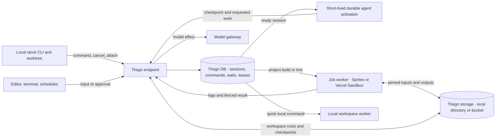

# Thegn agent platform architecture and delivery plan

Design and implementation handoff · 18 November 2026 · [Architecture review](https://linear.app/example/issue/THE-2315) · [Delivery initiative](https://linear.app/example/initiative/thegn-agent-platform-fe4dd6935d38)

**First release goal.** Keep the developer’s coding agent in their local terminal and free laptop CPU by sending a project’s builds and tests to Fly Sprites or Vercel Sandbox. Both providers are release requirements. The longer-term goal is for one person to direct 100 agents from a phone using the same execution contract.

### Decisions and outstanding proof

| Design question          | Decision for this plan                                                                                                                                                                                                                | Evidence or remaining choice                                                                                                                                                                                                                     |
| ------------------------ | ------------------------------------------------------------------------------------------------------------------------------------------------------------------------------------------------------------------------------------- | ------------------------------------------------------------------------------------------------------------------------------------------------------------------------------------------------------------------------------------------------ |
| What is a unit of work?  | A session owns a conversation. A command records one requested shell operation. A Job is a bounded execution against a pinned input. An environment lease keeps a live service available.                                             | Release fixtures distinguish a 40-minute finite build from a dev server that starts in two seconds.                                                                                                                                              |
| Where does an agent run? | Support the native stock CLI and an event-driven durable loop. Run trusted agent logic close to its state. Give untrusted code a qualified hardware boundary in hosted production.                                                    | Probe local Claude Code and Codex tool paths first. Qualify Pi core in V8 in the durable-agent milestone. A shared stock-agent host inside one approved domain, a WASM port of a stock CLI and VM memory restore each require separate evidence. |
| Who can change source?   | A workspace has one mutable authority. A Job receives an immutable root and returns artifacts and, when explicitly allowed, a candidate patch.                                                                                        | Ordinary editor-owned worktrees support patch review. Automatic multi-file apply requires a demonstrated write barrier and recovery.                                                                                                             |
| What can a customer buy? | Hosted Thegn is the managed standard server and its control database. Hosted Compute is a single bundle of agent hosts, runners and workload storage. Both work independently with the open-source endpoint.                          | The hosted launch gate exercises four combinations. Pricing, payments, enterprise BYOC and customer-managed database operations are deferred.                                                                                                    |
| Which guarantees travel? | Resource ownership, identity, isolation floors, receipts, result schema and effect semantics follow the work. Wake latency, storage durability class and available capabilities are explicit.                                         | Qualify each platform, harness, provider and template at a named version. Publish results for warm, cold and unavailable states.                                                                                                                 |
| What stays public?       | Job/CAS/lease/guest and provider contracts, compatible clients and black-box fixtures go upstream in Thegn. The managed server runs a release of Thegn. The compute service consumes published interfaces and can ship independently. | Advance OpenSpec for accepted behavior in each owning slice. Version the guest, public API, job schema and agent checkpoint independently.                                                                                                       |

Sections 1–5 describe the contracts an implementer needs for the laptop proof. Sections 6–8 cover hosted delegation, security, model access and recovery. Sections 9–11 give release gates, source anchors, the ready queue and issue ownership. All numeric performance targets in this RFC are proposed acceptance criteria until measured on the stated workload.

A developer opens Claude Code in a local worktree and asks it to fix a failing test. The same developer schedules a Thegn coding agent to investigate another failure overnight. Both can run the same test on the same builder. The first keeps a terminal process alive to receive the answer. The second can go away completely after requesting the test and pick up when the result arrives. Neither needs to own the builder.

Both agent paths use a durable work queue, the Thegn database for coordinated state and Thegn-managed storage on disk or in an S3-compatible bucket. The release order begins with remote command execution for a local agent. The offline stock/durable comparison follows. Pi, V8, WASM and hosted infrastructure each have their own qualification.

## 1. The system a developer runs

### First release · A local terminal with a project-selected runner

Open a stock coding CLI in its normal terminal. Edit a failing test in the current worktree. In a project configured for Sprites, running that test sends a Job to its authorized Sprite. Open a second project configured for Vercel Sandbox and repeat the command. Only the heavy command changes machines. The agent process, editor, checkout, native model login, local daemon, SQLite queue and directory CAS stay on the laptop. Users bring credentials for their selected provider. A Thegn cloud account and a shared bucket are optional.

| Project choice                                    | Where work executes                                                             | What the developer sees                                                                      |
| ------------------------------------------------- | ------------------------------------------------------------------------------- | -------------------------------------------------------------------------------------------- |
| No runner configured                              | Local execution under the applicable isolation policy                           | Ordinary local development with no provider spend.                                           |
| Project A selects Sprites for builds/tests        | The daemon sends the pinned input to a project-authorized Sprite                | Local edits and quick commands remain available while the remote process streams its output. |
| Project B selects Vercel Sandbox for builds/tests | The daemon provisions or claims a sandbox in the authorized Vercel team/project | The same terminal receives the command exit, failures and declared artifacts.                |

The project selects a named runner binding for eligible recipes. Only trusted configuration can authorize the provider account, grant paths, increase spend or loosen isolation. A repo can select or narrow those grants. Keep runner selection independent of the existing remote-worktree provider setting. Show the effective binding, matched command, allowed inputs and reason in the route inspector. Explicit CLI submission and the harness adapter share admission. Qualify at least one pinned stock CLI in its actual interactive mode. Scoped shims are sufficient for documented invocations. Advertise full shell capture only after the relevant paths pass their own tests.

1. Admit the command with a stable ID, deadline, trust policy, resource limit, working directory and allowlisted environment. Seal tracked edits, deletions and eligible untracked input into one snapshot. Transfer the authorized missing content via the provider file API or a verified bundle. Keep the provider credential on the daemon.
2. Persist the dispatch intent, placement and any returned provider handles. On an ambiguous create or start, reconcile under the original execution identity before a retry. Expose uncertainty when the provider cannot confirm execution. The worker uses a private checkout and trust-scoped caches. The agent's home and model login stay out of the snapshot.
3. Stream output to the initiating terminal with separate file descriptors in pipe mode. Return the command exit and declared artifacts. Preserve the local worktree as source authority. Route only recipes whose local output expectations can be met. A later local command that needs a built binary requires explicit artifact materialization or a qualified local workflow.
4. On Ctrl-C, fence publication and cancel the owned command. Track cleanup to provider confirmation or an explicit outstanding cleanup record. A remote-required recipe waits within its deadline or returns an actionable error on outage, denial, spend exhaustion or missing capability. Local execution or switching providers requires a separately authorized choice. The developer can keep editing during the failure.

**Release evidence.** Run one CPU-bound fixture on both projects from the same local CLI, including a failed test that passes after an uncommitted edit. Compare direct local execution with cold and warm runs on each provider using a matched idle control and at least five samples per condition. For this CPU-bound fixture the proposed acceptance target is at least 75% fewer median idle-adjusted laptop CPU-seconds on each provider across the full command, with zero local compiler/test process trees on every offloaded attempt. Use a positive, stable baseline and publish each cold and warm result separately. Include CPU spent in the local daemon, hashing, compression, transfer and terminal. Publish elapsed time, time to first output, bytes, cost, artifact digest, cancellation, reconnect and cleanup outcomes. A mock provider can qualify routing in CI. Each vendor also needs live evidence before the workflow is called supported. [Release gate](https://linear.app/example/issue/THE-2419)



On a laptop the endpoint, SQLite database, file-backed object store and local worker can all share the machine. The developer edits a normal Git worktree. A terminal disconnect or closed viewer leaves an accepted Job inspectable by ID. A sleeping laptop resumes its local dispatcher when it wakes. Overnight operation while the laptop is off needs an independently reachable endpoint that owns the agent and accepts its events.

| Part                     | Owns                                                                                                                          | Lifetime                                                                                            |
| ------------------------ | ----------------------------------------------------------------------------------------------------------------------------- | --------------------------------------------------------------------------------------------------- |
| Stock harness adapter    | Launch, native login and session identity, shell delegation, PTY, supported resume boundaries                                 | A CLI process for an active turn. Portable hibernation only at a proven boundary.                   |
| Durable agent host       | Load versioned agent code and state, deliver an event, calculate the next state and requested actions                         | One bounded activation. A waiting agent has a record, checkpoint and wake condition.                |
| Control plane            | Authenticate, sequence input, apply policy, accept commands, schedule workers, fence commits, meter usage and deliver results | Shared by agents. SQLite locally, Postgres for concurrent hosted authorities.                       |
| Workspace authority      | Writable checkout, coherent snapshot, current revision and permission to apply a candidate edit                               | Lives with its owner. Sealed snapshots survive the working copy according to their storage receipt. |
| Workers                  | Run shell programs, build, test or provide a leased dev environment. Return output and measured usage                         | Local persistent listener, disposable worker or warm capacity as configured.                        |
| Model gateway and broker | Approved inference, model effects and credential grants. Stock subscription logins use each supported first-party path        | Shared services. A command worker receives only credentials needed for its admitted command.        |

The daemon serves versioned operations over its existing local and remote transports. CLI, TUI, HTTP/gRPC and MCP call the same application handlers. Keep the Rust policy and state transitions substrate-free. Put filesystem work, SQLite calls, network transfers, PTYs and provider SDK calls on bounded workers outside the UI and event loop.

For day-to-day use, the developer selects a session and a worktree once. The terminal shows live output and the original command exit. The TUI and MCP can also show the command receipt, revision, worker, pending approval, cost and final artifacts. A sleeping session can show its diff or last test result without waking its agent. A cancelled Job, a failed test and a parked agent awaiting human input get distinct states. Start by extending existing launch and attach commands. Reserve final CLI spellings until they have been checked against current commands.

## 2. Two ways to own an agent turn

**Stock CLI.** Thegn launches a pinned harness with its existing interactive or headless behavior. The harness owns its prompts, model loop, tool decisions, authentication and transcript. A qualified shell adapter submits the complete shell invocation and waits for its stream and exit. While the CLI is blocked on a model connection, PTY or opaque tool call, budget for the small process remaining alive. Closing the viewer detaches. Between verified turns the adapter may freeze intake, flush an allowlisted home and workspace checkpoint, verify it outside the retiring host, then release the host. On wake, acquire a fresh session generation, restore a compatible harness and use its native resume command. An unknown delivery or resume state is inspectable by the user. Keep the prior checkpoint.

**Durable agent.** Thegn owns the loop and its portable state. The first implementation is a small first-party agent that can take a task, request a model decision, read a file, propose an edit, run a test, inspect the result and report back or ask for approval. Persist model messages, selected tool calls and completed effects with their policy-approved retention. Persist the exact model response before dispatching its chosen tools. On replay use the recorded decision. Agent state includes the objective, conversation references, tool-call IDs, pending waits, workspace reference and runtime/schema version. Model context is reconstructed from that state. File contents and full tool logs are retrieved by authorized reference and bounded before entering context.

The runner interface can be implemented by a short-lived Rust process first. Conceptually, `advance(checkpoint, event, recorded_inputs) → {next_checkpoint, effects[], wait, reply}`. All observable I/O becomes a named effect. Supply time, random choices and versioned configuration through recorded inputs where they influence decisions. The runtime gets scoped tools for model calls, workspace operations, commands, approvals, timers and replies. Constrain execution time, memory, payload size, and the number of actions per activation. Park an incompatible checkpoint for migration with the previous code digest available. A fork gets a new identity and effect namespace.

**Pi Durable and portable runtimes.** Qualify a Pi Durable adapter by mapping one external thread to one Thegn agent, forwarding tool calls with stable IDs and assigning one owner to each checkpoint, retry and timer. If deployed as a Rivet Actor, Pi's store owns the internal loop and Thegn owns commands and external receipts. In the fully Thegn-managed case the adapter must demonstrate checkpoint/export, import and tool resumption on a clean host with the Thegn DB and storage. Until then the first-party loop is the reference. A JS agent with supported imports can later run in V8. A compiled component can run with a Wasmtime host. Both use the same activation contract. Qualify module dependencies, storage, memory limits and termination per host. The existing Pi CLI remains a stock harness. [Pi Durable architecture](https://rivet.dev/ecosystem/pi-durable/) · [Wasmtime security model](https://docs.wasmtime.dev/security.html)

A native agent owns its tool UX, approval rules, edit strategy, conversation history and model integration. It can reproduce a familiar coding workflow. Offer model access through an authorized provider credential or separately approved integration. A developer using their individual subscription in a supported stock CLI keeps that login with the harness. Exclude login material from jobs, CAS manifests and replay. Show model spend as measured, estimated, subscription usage or unknown according to the evidence available. [Claude Code deployment policy](https://code.claude.com/docs/en/legal-and-compliance) · [Model gateway RFC](https://linear.app/example/document/thegn-model-gateway-architecture-and-delivery-rfc-50c573f30172)

### Experiment: hibernate a stock CLI between turns

A developer leaves a Claude Code or Codex tab idle, returns to the same tab and continues the same conversation in the current worktree. Try this first with graceful exit and native session resume. Compare whole-VM restore only for a long-lived CLI in a dedicated, compatible guest. Keep automatic parking opt-in. The local-terminal release can ship independently of this experiment. [Experiment and qualification matrix](https://linear.app/example/issue/THE-2420)

| Launch mode                | Evidence that permits parking                                                                                                                                                                                | What wakes                                                                                                                                                                      |
| -------------------------- | ------------------------------------------------------------------------------------------------------------------------------------------------------------------------------------------------------------ | ------------------------------------------------------------------------------------------------------------------------------------------------------------------------------- |
| Claude Code interactive    | Bind the native session ID to this launch. Treat `Stop` as a candidate. Another hook can continue the turn. Confirm hooks have settled, the prompt is idle and no owned work is outstanding.                 | Reattach the original terminal slot and use `claude --resume <id>` against the verified session store and intended cwd. Optionally compare a VM restore.                        |
| Claude Code one-shot print | The process exits, its result and persisted session ID are captured, and the transcript can reopen. A persistence-disabled run is ineligible.                                                                | The next authorized input starts `claude -p --resume <id>`. The completed process has already released its memory.                                                              |
| Codex app-server           | Bind the terminal to the exact thread and turn. Inspect the status on `turn/completed`, unresolved server requests and live tools. Interrupted or failed work with an uncertain effect needs reconciliation. | Reinitialize the transport, use `thread/resume` on the exact ID, verify the last turn and then admit new input. Shared app-server shutdown requires every owner to be eligible. |
| Codex TUI or exec          | Prove a native ID for this launch and qualify the mode separately. Test two sessions in the same cwd. Keep ambiguous unmanaged tabs awake.                                                                   | Use `codex resume <id>` interactively or `codex exec resume <id> <input>` for a headless next turn. Preserve the approved launch profile and terminal slot.                     |

Anthropic documents hook continuation and configurable session persistence. OpenAI documents persistent threads, resume and terminal turn notifications. These interfaces establish the native restart baseline. Whole-VM restoration and interactive terminal fidelity require their own tests on pinned versions. [Claude Code hooks](https://code.claude.com/docs/en/hooks) · [Claude CLI reference](https://code.claude.com/docs/en/cli-reference) · [OpenAI Codex app-server](https://learn.chatgpt.com/docs/app-server)

**Park.** Offer a visible sleep state and a session pin. Veto automatic sleep for a focused tab, unsent draft, approval dialog, active model stream, background shell, running tool or subagent, session timer, or uncertain ownership. Close admission before the final check and journal input arriving during the transition. Flush and verify the native session, including consistent sidecar/database state as needed. The encrypted checkpoint records exact native ID, adapter/build, principal, cwd, workspace revision, latest terminal turn and related Job receipts. Retain the current owner or its recoverable state if verification fails. Reopening a laptop tab always respects its current editable worktree. Fetch credentials through the supported local or brokered path on wake. If restored history or login cannot be verified, keep the checkpoint and show what needs attention.

**Optional VM acceleration.** After verifying the disk checkpoint, quiesce writers and take a consistent guest disk, RAM and device-state snapshot at the same boundary while the CLI is still alive. Bind it to one owner and generation, expiry, encryption key, CPU features, VMM/state format, kernel and image. RAM can contain OAuth or tool credentials: enable the path only where custody, revocation, retention and deletion are acceptable. Confirm the prior guest has stopped or is isolated even from external credential use before giving a restored instance network or input. A queue fencing token alone cannot invalidate an ordinary provider login. Reconnect control channels, validate wall clock, guest entropy, network policy, native identity, PTY and necessary MCP connections with a read-only probe. Recreate stale transports. Generic process checkpointing and mid-turn capture are outside the experiment. [Firecracker snapshot support](https://github.com/firecracker-microvm/firecracker/blob/main/docs/snapshotting/snapshot-support.md)

**Recover.** If the compatibility or readiness check fails **before** delivering the next input, retire the failed instance and cold-resume the exact native session. Once the input may have reached the CLI, model or tool, reconcile its turn and Job receipts before considering another send. An ambiguous outcome remains visible for human resolution. This gives a stock agent conversation continuity between completed turns. Only an agent with a durable effect journal can offer the separate replay guarantees described above.

| Prior art                                                                       | What Thegn can use                                                                                                                                                                                                                                                         |
| ------------------------------------------------------------------------------- | -------------------------------------------------------------------------------------------------------------------------------------------------------------------------------------------------------------------------------------------------------------------------- |
| [drkh-n/claude-hibernate](https://github.com/drkh-n/claude-hibernate)           | A PTY wrapper recognizes quota warnings, gates input and visibly waits for reset with Claude still running. Borrow the clear paused state. Count its resource use as resident.                                                                                             |
| [SteveVitali/claude-hibernate](https://github.com/SteveVitali/claude-hibernate) | A disk manifest restores terminal sessions by cwd and native Claude ID after reboot. Prefer its hook-reported identity. For same-cwd sessions with only heuristic matches, require explicit identification. Revalidate saved launch options under current policy.          |
| [rhuthik/tabnap](https://github.com/rhuthik/tabnap)                             | Graceful exit, same-pane wake and draft/background-work vetoes provide the closest local UX. It documents ambiguity when matching unmanaged Codex tabs and the memory a shared app-server can retain. Measure resources across the whole process tree and shared services. |

**Code review of the three terminal implementations**

- **drkh-n.** The CLI requires a TTY and hands control to `Hibernator.run`. The wrapper polls the child PTY, scans both an ANSI-stripped tail and reconstructed screen rows, cycles the child to Manual mode, and keeps draining its output beneath the lock screen. It redraws and rearms detection after unlock. The PID, heap and terminal are resident throughout. Use this as a fixture for “paused yet still allocated” and quota text split across redraws. Thegn needs independent turn and resource receipts. [PTY wrapper](https://github.com/drkh-n/claude-hibernate/blob/d3a4afac216e5dc286ca2f4504eee574c328a742/claude_hibernate/wrapper.py#L185) · [CLI](https://github.com/drkh-n/claude-hibernate/blob/d3a4afac216e5dc286ca2f4504eee574c328a742/claude_hibernate/cli.py#L43)
- **SteveVitali.** `collect_running` resolves the process, directory and native ID. It prefers hook records or an explicit resume argument, then groups transcript candidates by project and modification time. The schema-2 writer uses a temporary file and rename. `cmd_wake` consults locally running sessions before launching an exact resume command in a terminal. A local running-process check cannot serialize concurrent hosts. Test two suspended sessions in the same cwd, two simultaneous wakes, and a tighter permission policy at resume. Keep a transactionally claimed generation and revalidate saved flags. [Discovery and manifest](https://github.com/SteveVitali/claude-hibernate/blob/65688ec0ed60ce3bd39f6784ea64ab8cef6661bd/scripts/claude-hibernate.sh#L419) · [Wake](https://github.com/SteveVitali/claude-hibernate/blob/65688ec0ed60ce3bd39f6784ea64ab8cef6661bd/scripts/claude-hibernate.sh#L943)
- **tabnap.** The Claude adapter reads native session status and checks for drafts, dialogs and background work. The Codex adapter distinguishes an explicit thread ID from a time-based match. Immediately before quitting, the engine rechecks process start, native session, idle state and screen. It reconciles the ID printed at exit and retains a picker on an uncertain manual match. Its displayed freed-memory figure is assembled from a pre-exit process-tree sample. Measure actual post-exit RSS, shared app-server lifetime and remote allocation separately. Test draft arrival after the scan, PID reuse, a shared app-server and an unconfirmed exit. [Engine](https://github.com/rhuthik/tabnap/blob/ea13260cc63ed29d4a01e90579b4b4ddc68f8b3d/src/tabnap/engine.py#L351) · [Codex](https://github.com/rhuthik/tabnap/blob/ea13260cc63ed29d4a01e90579b4b4ddc68f8b3d/src/tabnap/agents/codex.py#L68) · [Claude](https://github.com/rhuthik/tabnap/blob/ea13260cc63ed29d4a01e90579b4b4ddc68f8b3d/src/tabnap/agents/claude.py#L106) · [Tests](https://github.com/rhuthik/tabnap/blob/ea13260cc63ed29d4a01e90579b4b4ddc68f8b3d/tests/test_agents.py)

**Implementation ownership.** [Claude native restart](https://linear.app/example/issue/THE-2421) and [Codex native restart](https://linear.app/example/issue/THE-2422) qualify independently. [VM comparison](https://linear.app/example/issue/THE-2423) starts once at least one disk-native mode passes. The parent collects per-mode outcomes, including an unsupported verdict. No child gates M1.

**Qualification.** Compare resident idle, native disk resume and whole-VM restore after **1 minute, 1 hour and 48 hours**. Exercise a compatible replacement host, changed network, expired credentials, incompatible image/CPU, concurrent wake, input racing park, missing history and a lost acknowledgement after input. Include a dirty workspace edited while parked and a vetoed mid-turn attempt. For each pinned harness/mode/backend, record exact conversation and last turn, one new turn and its effects, manual intervention, terminal usability, local RSS, remaining processes or billed remote allocation, snapshot bytes and cost, and p50/p95 time to input-ready and first useful response. Requalify on CLI, adapter or VMM changes. Enable the faster path only where it passes recovery checks and improves measured user-visible wake time.

### What gets to execute beside a credential

Publish a capability matrix per harness version, OS, launch mode and trust policy. Record supported auth mode, native file edits, shell capture, arbitrary extensions, headless mode, PTY, session lookup, before-turn/after-turn signals, portable resume and encrypted-home requirements. A successful startup only qualifies startup. Record whether a CLI's own updater or user-installed plugin changes the qualified image. Operators should be able to pin and roll back a known-good profile.

- **Stock or selective.** Start the vendor program as shipped. Preserve extensions and interactive behavior inside its admitted sandbox. Shims can offload known tools. Show the coverage mode to the user.
- **Managed full capture.** Pin the binary, environment and approved executable extensions. Broker shell and tool access at every qualified boundary. A project hook, local MCP subprocess or in-process Pi extension can introduce executable code outside a shell shim. Treat each of those as a separate capability. Use a full-feature isolated guest when user customizations require it.
- **Portable agent.** Test Pi core with a deterministic model, a workspace API, an edit proposal and a command effect. Kill the JS isolate after persisting a wait, redeliver a result to another host, and verify one continued turn. An actor-backed Pi Durable deployment can remain the owner of its internal checkpoint. The Thegn-managed path must restore using Thegn metadata, scoped objects and the pinned module. Wasmtime is a candidate for a purpose-built Rust agent. The current stock Codex and Claude Code integrations qualify against their native programs. A language-runtime port must demonstrate its own login, approval, streaming, file/tool and resume behavior.
- **Shared host experiment.** Start with a fresh single-tenant guest per hosted stock workload. A later experiment may place multiple separately sandboxed stock processes inside a domain VM explicitly authorized for the same owners, credentials and policy. Benchmark 1, 10 and 100 active sessions and test cross-session read, attach and credential denial. Retire the entire guest at the domain boundary. A sandboxed JS host also needs a host-level isolation review before accepting arbitrary modules. [Pi extensions](https://docs.pi.dev/latest/extensions) · [Codex app server](https://learn.chatgpt.com/docs/app-server) · [Claude Code hooks](https://code.claude.com/docs/en/hooks) · [workerd security model](https://github.com/cloudflare/workerd#security)

## 3. The public boundary and the records behind it

Each mutation carries a scoped principal and idempotency key. Duplicate key and equal canonical payload return the first receipt. A changed payload under the same key returns a conflict. A handle includes its owning endpoint. Admission resolves tenant, profile, zone, repo, worktree, agent and turn from trusted bindings. Capabilities and protocol versions are negotiated before accepting work with special requirements.

| API family             | Minimum operations                                                        | Semantics a caller can rely on                                                                                                                                            |
| ---------------------- | ------------------------------------------------------------------------- | ------------------------------------------------------------------------------------------------------------------------------------------------------------------------- |
| Agents and events      | Start, send input, approve, watch from cursor, attach, park, wake, cancel | Durable input receipts, ordered per-agent delivery, generation-fenced activation, explicitly qualified stock attach and resume.                                           |
| Workspaces and objects | Snapshot, read, diff, propose/apply patch, list missing, put, get         | Stable root and revision, scoped reachability, verified content and a durability receipt.                                                                                 |
| Commands and Jobs      | Submit shell or argv, watch, stream, input, signal, cancel, result        | One logical shell request per tool invocation. A bounded snapshot command links to its Job, shards, attempts and result. A synchronous caller waits on the same resource. |
| Live environments      | Acquire, renew, sync revision, list/open port, release                    | Private session and port grants, authoritative expiry and cleanup receipt. Expose a distinct resource from the worker's attempt lease.                                    |
| Workers and caches     | Enroll, advertise, claim, renew, stage, commit, get receipt               | Authenticated capability inventory, authoritative epochs and grants scoped to the input root, output class and attempt.                                                   |

The following are logical records, suitable for transaction and uniqueness tests. Reuse repository types and storage tables where they already satisfy the invariant.

| Records                         | Key or concurrency rule                                                                        | What is durable                                                                                                                              |
| ------------------------------- | ---------------------------------------------------------------------------------------------- | -------------------------------------------------------------------------------------------------------------------------------------------- |
| Agent and checkpoint            | Agent ID, tenant, generation, version, checkpoint root and last consumed sequence              | One active generation. A checkpoint includes the agent implementation digest, state schema and logical workspace path.                       |
| Inbox and wait                  | Unique source event ID within agent, ordered sequence, correlation key and condition           | Accepted input, completion, timer, approval or cancel. A ready session can be rediscovered after a lost notification.                        |
| Effect and outbox               | Unique agent, decision sequence and effect slot. Outbox rows committed with state              | The tool/model operation, request digest, policy, external handle, outcome and acknowledgement.                                              |
| Command, Job, shard and attempt | Scoped submit key, logical command ID, job/shard ID, attempt ID and monotonically issued epoch | Work identity survives retries. Attempt records preserve every physical execution and resource charge.                                       |
| Workspace, roots and grants     | Home authority, workspace revision, root digest, pin owner, expiry and required durability     | The mapping from a workspace or checkpoint to its reachable files. A digest alone conveys no read or list permission.                        |
| Usage, streams and receipts     | Unique usage IDs per billable unit, attempt and stream cursor, accepted commit ID              | Separate model spend, agent active time, worker time, storage/transfer and shared standby. Lost acknowledgements can be recovered by lookup. |

Large bytes live in managed storage. The database owns the authoritative pointers. Stage immutable blobs, verify hash and size and required replication, then commit the pointer and pin. Failed transactions leave reclaimable staging. Keep in-flight upload pins or a grace window through publication. Garbage collection traces live roots, retention and unfinished operations. Restore requires DB backup or exported root catalog **and** readable object closures and keys. A bucket by itself cannot reconstruct queue order, latest session generations or users' grants. Restore tests include a clean machine.

### Job, guest and store contracts

One JobSpec version describes OCI or locked Nix environments, ordered argv or shell steps, services in the job network namespace, resource shape including shared memory, isolation floor, placement constraints, named caches, shard count, deadlines, retry budgets, result parsers and declared artifacts. Resolve moving references once at admission, including sidecar images. Reject ambiguous command forms, missing required capabilities and unknown execution fields. A single offering must satisfy the complete requirement set. Use one-based shard numbers at the public boundary and translate provider indexes at the adapter.

Example submitted from either agent. Resolve the image tag and current workspace to digests before assigning a worker.

```yaml
apiVersion: thegn.dev/jobs/v0
kind: Job
metadata: { name: web-tests }
source: { snapshot: auto }
environment: { image: "ghcr.io/acme/test:approved" }
isolation: microvm
steps:
  - name: test
    run: npx playwright test --reporter=junit --shard=${THEGN_SHARD}/${THEGN_SHARDS}
shards: 4
env: { PLAYWRIGHT_JUNIT_OUTPUT_FILE: test-results/junit.xml }
results: { junit: test-results/*.xml }
artifacts: [test-results/]
timeout: 30m
```

The small public `JobResult` carries terminal status/reason, shard and attempt lineage, selected test failures and diagnostics, bounded log tail plus full log references, artifacts, cache statistics, phase timings, admitted placement and attributable cost. Four logical shards with three additional physical attempts across two hosts still produce a single logical result containing only the selected outcome per shard. A rejected Job can have zero attempts. Preserve missing reports, infrastructure retries, truncated output and uncertainty as distinct facts. Full output requires authorization on the referenced objects.

For each shard claim the authoritative transition is queued → leased → preparing → running → committing → terminal. A preemption or lease expiry ends the physical attempt. Only a replay-eligible shard with remaining allowance gets a fresh attempt and higher epoch. Reject a commit bearing any unissued epoch. A new writer's publication is conditional on the exact live lease and object closure. Timeout, cancellation and result acceptance serialize against the same row. Persist the selected result, list of newly reachable roots, usage evidence and wake outbox atomically. A lost reply recovers the committed receipt even after the original lease expires.

The guest protocol starts with bounded length-prefixed protobuf frames. Negotiate protocol, spec versions, capability bits and size limits. Assignment binds worker, command/job/shard/attempt, exact epoch, image and input digest, expiry and object grants. Sequence step, stream and byte offset for output resumption. Reserve independent control capacity for heartbeat, cancel and preempt. Transfer large blobs outside the control channel. Host-to-guest transports can be a local socket or vsock. An enrolled remote node uses the authenticated connect-back channel. A phone holds a scoped session token and cannot claim worker leases.

Use operation-shaped store methods such as admit-or-replay, claim-shard, renew-if-current, publish-or-replay, advance-agent and cancel-if-open. Implement each as the smallest transaction that preserves its invariant. For federated operations persist the mapper and outbox at the source, use the same operation key on retry and reconcile with the destination. Avoid distributed transactions across a customer's database, our service and object storage. Cap queues, payloads and logs per principal. A busy but eligible pool returns pending with an observable deadline. An impossible hard constraint returns its reason before execution. [Job contract and compatibility vectors](job-spec-v0.md)

## 4. How a sleeping agent gets a reliable answer

1. Input arrives with a stable ID. The authority inserts it into the inbox and marks the agent ready in one transaction. A shared dispatcher leases an activation generation. It loads the pinned code and checkpoint, then delivers the next eligible event.
2. The agent decides to run a test. The authority stages the next checkpoint, then in one transaction checks the generation and cursor, consumes the input, updates the checkpoint, creates the effect plus command or dispatch outbox, and registers the wait on that effect. A local command is immediately discoverable. A delegated command uses the effect ID as the remote submit key. The runtime may now exit.
3. Workers pull eligible work. Claim atomically assigns the attempt, worker ID, exact epoch and authority-clock expiry. Heartbeats renew only at the authority. Slow logs use a separate bounded stream. The worker pins the input, prepares its environment, executes, streams progress, stages outputs and requests a fenced commit.
4. Commit verifies the current worker, attempt, exact epoch, allowed phase, expiry, grants and referenced bytes. In one DB transaction it records the winning result, usage receipt and completion event or durable outbox. Same accepted payload returns the same receipt after a lost response. Another payload conflicts. Attempts that lost the race still have separately attributable compute usage.
5. The event dispatcher satisfies the wait or finds the stored result on reconciliation. A duplicate completion resolves to the same inbox identity. A fresh activation reads the result and continues. If the result existed before a wait was registered, wait registration checks the result under the same serialization rule. For parallel tools, persist an explicit set of expected effect IDs and the join policy. Unrelated input remains ordered and visible while waiting. Cancellation can preempt the wait.
6. A model call uses the same effect journal and its own budget reservation. Publish streamed text as provisional until the provider result is committed. Reconcile a provider handle or an honored idempotency key after an ambiguous send. If neither exists, mark the call uncertain, retain the financial reservation or conservative estimate, and ask for an explicit retry. The same rule applies to a publish, deploy or other externally visible operation.

Delivery is at least once. Thegn gives a logical result one authoritative publication. Separating those guarantees matters when a worker loses the connection immediately after a command has affected another system.

For v0 use the database's time for claim, renewal, cancellation and expiry. A candidate starting profile is a five-second heartbeat and thirty-second TTL for remote workers. Tune from observed pause and cross-region latency. Only the authority can extend publication rights. Use a bounded transactional claim in SQLite and row-level locking in Postgres. Retry ordinary contention with a deadline. On both, use conditional transitions and unique keys for the same domain invariants. A notifier makes work promptly discoverable, and a periodic shared scan finds expired claims or missed notifications.

An agent cancel revokes future activations for the old generation and requests cancellation of its unshared child effects. Already completed results remain inspectable. A separately pinned dev environment retains its own owner, TTL and budget. Distinguish managed cleanup pending from provider-confirmed release. Publish a user's approval against the exact proposed effect, workspace revision and policy generation. If any change, require a fresh authorization.

## 5. Shell, files and interactive development

Every shell-tool invocation in a qualified managed harness goes through the queue, even on the laptop. Queue the entire `cd app && cargo test | tee out` program, shell dialect, cwd, allowed environment, stdio/PTY mode, umask, deadline and effect policy. Preserve argv boundaries for direct execution. Built-ins, redirection and compiler subprocesses execute together on the selected worker. An agent's native edit tool still writes through the workspace authority. Capture at the harness's shell boundary. PATH shims are a selective option. Advertising full interception requires tests for absolute executables, built-ins and alternate exec paths with direct execution denied or delegated.

| Command shape                                                           | Worker choice                                                                                                                      | Developer-visible result                                                                                                                                                               |
| ----------------------------------------------------------------------- | ---------------------------------------------------------------------------------------------------------------------------------- | -------------------------------------------------------------------------------------------------------------------------------------------------------------------------------------- |
| Search, status, opaque shell or command needing local files/descriptors | Nearby authorized workspace worker with the current revision and appropriate isolation                                             | Sees the developer's last edit. Tiny commands avoid snapshot upload and cold provisioning. A stateful terminal requires a pinned shell handle.                                         |
| Qualified read-mostly build or test                                     | Local or remote snapshot worker with the environment digest, optional cache and trust floor                                        | Live logs and exit, structured test summary and artifacts. Commands depending on a subsequent local executable use the workspace worker or explicitly materialize a declared artifact. |
| Formatter, lockfile writer, generated files                             | Workspace worker, or an admitted snapshot Job that returns an allowed source patch                                                 | Preserve original exit and patch outcome independently. On an ordinary laptop Git worktree, return a reviewable patch by default.                                                      |
| Dev server, debugger or browser                                         | Explicit environment lease with expiry, budget and tunnel                                                                          | The edit stream advances a known workspace revision. A gap triggers resync. Port ownership and access expire with the lease.                                                           |
| Publish, deploy or other external effect                                | Explicitly authorized worker and effect policy, on-demand, automatic replay disabled unless the destination guarantees idempotency | An ambiguous outcome is visible for reconciliation.                                                                                                                                    |

One authority owns the mutable workspace. A snapshot is a coherent Git tree plus tracked edits, deletions and eligible untracked files with protected exclusions. Snapshot under a proven barrier or use an immutable/copy-on-write view. If an external editor prevents proving consistency, retry or report that snapshotting is unavailable. Isolated Jobs write to a private overlay. Scope caches by tenant, trust, platform and toolchain. Agent-authored work gets read-only shared caches by default. A candidate source patch contains before/after digests, paths, base root and winning receipt. Apply with current authorization and a revision check. Atomic multi-file apply requires control over all writers. Preserve concurrent edits and provide a conflict/review handle. Reflink or copy mutable files when materializing a checkout.

Retain per-attempt log cursors and stream identities. Preserve separate stdout/stderr in pipe mode and merged PTY semantics when requested. Bound stdin and output buffers. Record truncation and retention gaps. Send resize and signals through authenticated control frames. A viewer disconnect detaches. Explicit cancellation targets the process group and fences publication. After preemption, show an attempt boundary through a status channel and keep machine-readable stdout clean. For commands whose pipe consumer has already observed bytes, require a reconnect-aware client or surface interruption instead of silently replaying a possibly different stream.

### Routing agents through MCP and the native shell

Start with two agent-facing actions. `run_command` accepts one argv vector or a whole shell program, a workspace-relative cwd, optional hints, declared outputs and either wait or return-handle behavior. `start_service` requests a live process with readiness, TTL, required ports and edit-follow policy. Return a stable receipt as soon as admission is durable. Related operations read status, output and artifacts, send input, cancel a command, or renew and release a live environment. A service request that exceeds the provider's capabilities fails during admission. A foreground process continues to own its stream until exit or an explicit detach.

| Invocation                            | What the model can say                              | How the authority decides                                                                                                                                           |
| ------------------------------------- | --------------------------------------------------- | ------------------------------------------------------------------------------------------------------------------------------------------------------------------- |
| `git status` after a native file edit | Run in this workspace                               | Use the authorized working copy after its latest edit is visible. Preserve Git metadata and cwd.                                                                    |
| `cargo test` on a large worktree      | Run a finite test, remote preferred                 | Check declared toolchain, cache and outputs, then score eligible local or remote snapshot workers on measured completion time, locality and cost.                   |
| `npm run dev` for browser iteration   | Start a service and expose a private port           | Resolve a qualified recipe or explicit lease request. Wait for actual readiness, scope the tunnel, observe edit revisions, and stop on release or TTL.              |
| Opaque pipeline or local socket       | Run this complete shell on the existing environment | Preserve process-group, redirection, same-shell and filesystem semantics. Refuse if the requested state cannot be safely provided.                                  |
| Provider disappears after submission  | Look up my command                                  | Consult its recorded authority and key. Try another eligible worker only after establishing safe replay and honoring deadline, isolation, budget and data location. |

MCP is the preferred expression of intent. The model can still select a native tool. Register the Thegn tools per session and route the stock harness's actual shell boundary into the same command authority. Thegn-owned agents can receive only those command capabilities. Never infer a stronger enforcement mode from a prompt, hook or PATH setting. Record requested and actual route, policy generation, duration, bytes and a reason for fallback. Measure how often models use MCP and how often native capture succeeds. The user should receive the same exit, artifact, cancellation and billing semantics either way. [MCP tools](https://modelcontextprotocol.io/specification/2025-11-25/server/tools)

### Storage and cache ownership

Scope access by tenant, workspace, run and reachable root even when identical bytes have identical SHA-256-plus-size addresses. Canonical REAPI directory/tree encodings pin paths, executable bits, symlinks and child digests. The authoritative workspace includes tracked edits, untracked policy and deletions relative to Git. Per-agent home, workspace source, tool cache and immutable artifacts have distinct roots, grants and retention. Verify byte sizes and digests during transfer. Renew grants separately from ownership. Encrypt private session state and exclude login databases, auth tokens, agent sockets, host homes and unapproved transcript material from checkpoints.

| Layer                | Contents and write authority                                                                                        | Failure behavior                                                                                                                                            |
| -------------------- | ------------------------------------------------------------------------------------------------------------------- | ----------------------------------------------------------------------------------------------------------------------------------------------------------- |
| Local working copy   | Real filesystem for the editor, Git, language services and live workspace commands                                  | Seal one coherent input or report retry. Agent and worker guards never replace the user's external editor lock.                                             |
| Host-local cache     | Image layers, qualified dependency and compiler caches keyed by platform, repo, toolchain, build settings and trust | An inventory miss rehydrates data. Writable layers are private and disposable.                                                                              |
| Bucket or pool cache | Verified immutable cache chunks and staged manifests, build archives and artifacts                                  | Manifest publication is fenced. An interrupted or untrusted writer cannot move the trusted cache pointer.                                                   |
| Durable origin       | Acknowledged source roots, checkpoints, results and the blobs reachable from them                                   | Retain pins, catalog and recovery keys across collection, host retirement and backup. A returned durable receipt states the actual promised failure domain. |

The local provider can transfer missing objects directly to a remote node when policy permits, or use an S3-compatible bucket. The hosted origin is part of the compute bundle. Cache tiers may write back asynchronously for expendable data. If a receipt promises survival of a pool loss, verify an independent copy before acknowledging it. Use lazy restore or block clones for large cache volumes only after workload benchmarks. Inspect signed Nix cache promotion separately from generic compiler-cache writes. A protected source patch excludes build output, secrets and Git administration under every sync policy.

## 6. Local, remote and hosted placement

### Two independent hosting choices

**Hosted Thegn** runs the Thegn server for the user, including its control-plane database, sessions, settings and access from the phone. **Hosted Compute** is one bundle covering agent hosting, job runners and managed storage for workspaces, checkpoints, caches and artifacts. A self-hosted Thegn server can connect to the same bundle. Choosing the bundle makes all three capabilities available together.

| Thegn server | User-provided compute and storage                                                     | Hosted Compute bundle                                                                                    |
| ------------ | ------------------------------------------------------------------------------------- | -------------------------------------------------------------------------------------------------------- |
| Self-hosted  | Everything runs on the user's infrastructure.                                         | The user's Thegn server delegates work to our agent hosts and runners and can store the results with us. |
| Hosted Thegn | We operate the server. The user's connected machines and storage serve the workloads. | We operate the server, agent hosts, runners and storage.                                                 |

The server's own database belongs to the server offering. Workload storage belongs to the compute bundle. Agent hosts, runners and storage can still scale independently behind that bundle. Enterprise options such as customer-managed cloud pools are deferred.

| Deployment                        | State and storage                                                                                           | Where compute runs, and what survives                                                                                                                                                                                                                        |
| --------------------------------- | ----------------------------------------------------------------------------------------------------------- | ------------------------------------------------------------------------------------------------------------------------------------------------------------------------------------------------------------------------------------------------------------ |
| Fresh laptop                      | OS principal, SQLite, per-user directory CAS, local working copy                                            | Agent and worker share the laptop. A supported installed isolation backend is required for its trust class. A reboot recovers committed data. Disk loss needs backup.                                                                                        |
| Laptop plus bucket and/or builder | Local workspace and agent authority, optional verified S3 copy, scoped transfer of missing blobs            | A local stock CLI can wait on a remote builder. A bucket is optional when direct authorized transfer meets durability requirements. A builder can finish while the laptop is offline only within its delegation/lease contract.                              |
| Team endpoint                     | Reachable shared authority, SQLite with a single writer service or Postgres, shared bucket and restore plan | Shared ingress accepts offline-user events. Warm workspace workers, small agent runners and build hosts scale independently.                                                                                                                                 |
| Hosted Compute                    | Tenant-scoped execution state, verified origin and pool cache tiers                                         | The same API admits a local or delegated workspace root. Each untrusted workload receives a fresh hardware-isolated guest. A failed pool loses eligibility. Surviving eligible pools can finish qualified retries once independent pool recovery has passed. |

Filter on actual arch, OS, resolved image/toolchain, workspace locality, isolation, provider/region allowlist, effect safety and available budget before scoring. Prefer warm caches and short expected completion time among eligible offers. No eligible route returns its failed constraints. Purely local and mixed deployments use the same rules. Local fallback after an uncertain remote submit first looks up the original receipt. The stock agent host budget and builder budget are separate. A cheap remote sandbox that can launch a stock CLI is a candidate even when it cannot compile the project. Admit it after testing credentials, workspace, shell interception and resume.

Keep an interactive lane for workspace commands with bounded per-principal concurrency and a separate cap for long builds. Use weighted fair admission and aging so a stream of tiny commands cannot starve a background Job. A homogeneous idle local pool can dispatch immediately. In a fleet, match demand to idle slots in rounds and let a supply planner adjust pool targets using health, queue age and budget. Shards share the pinned input and image, receive independent attempt leases, and spread over failure domains when eligible. Aggregate the selected terminal attempt per shard once. Failures and diagnostics are bounded in the agent's context, with full logs and artifacts available on demand.

On Linux qualify bwrap for eligible workspace access and a VM-capable local worker when policy requires hardware isolation. On macOS qualify a small virtualization-backed host with its file-sharing and PTY behavior. Native macOS toolchains require explicit trusted-host admission. For Windows or any host without a passing runtime fixture, report exactly which managed operations are available. Pin the sandbox image and resolved toolchain for a snapshot Job. Prefer an explicitly declared environment, then an unambiguous recognized lock/toolchain recipe. Ask for an environment when competing declarations cannot be reproduced. A fresh laptop can run offline fixtures using installed tools and images. Inference or missing image downloads have their own connectivity requirements.

On the first hosted deployment use one authoritative Postgres writer per resource, one shared wake dispatcher and one qualified Kubernetes microVM pool. Use a per-run guest, private networking, scoped object grants and attested or operator-verified runtime capabilities. The published OSS API, guest protocol, contract fixtures and optional service adapter form the boundary between repos. Multi-pool matching and supply planning follow measured demand. Use tenant fairness, region constraints and bounded spot retries. Restrict the first pool and recovery tests to service-operated infrastructure. Verify acknowledged outputs outside a pool before advertising pool-loss durability. Replication to another region must respect residency.

### Delegation across the two products

Hosted Thegn operates session identity, approvals, workspace mappings and the phone endpoint. Its operational database is included with the server. Hosted Compute operates capacity admission, remote attempt leases, clean agent guests, runners and durable workload storage. A customer's Thegn binary uses the same compute provider interface as ours. The service may expose only the resource families it owns. Both endpoints report capability and durability classes and issue authority-qualified handles.

| Request from the phone        | Session authority                 | Execution and storage authority                                           | Disconnect behavior                                                                                                                                                                |
| ----------------------------- | --------------------------------- | ------------------------------------------------------------------------- | ---------------------------------------------------------------------------------------------------------------------------------------------------------------------------------- |
| User runs everything          | User's daemon                     | Configured local or private workers and store                             | Accepted local work recovers from SQLite on restart. An offline laptop cannot accept new remote input.                                                                             |
| User buys Hosted Compute only | User's daemon                     | Bundle endpoint accepts a bounded execution with scoped inputs and budget | Remote work can complete within the accepted delegation. Reconnect to import the result. New autonomous turns require a reachable home or an explicitly delegated agent authority. |
| User buys Hosted Thegn only   | Our managed release of the daemon | User-enrolled worker and workload storage                                 | The phone can still review retained metadata and send durable input while a private worker is unavailable. Execution exposes its queue reason.                                     |
| User buys both                | Our managed release of the daemon | Same compute bundle endpoint available to independent users               | Session authority accepts input and wakes work while the user's devices are offline. Compute and server have independent failure domains.                                          |

Consider a self-hosted endpoint dispatching a test. The local DB commits a command, a root pin, a maximum authorized cost and an outgoing request ID. The compute endpoint authenticates the origin and tenant, verifies the narrowed grant, and binds that ID to one remote Job. Workers receive only the allowed snapshot and staged output paths. The remote commit produces a result pointer, attempt history and usage receipt. The local authority imports and verifies the required roots before waking its agent. A callback is a notification; receipt lookup works after an outage. Reusing the key with different input fails. Reject delegation cycles and bound depth. Revocation stops fresh work. Retain the ability to reconcile prior accepted operations under the applicable retention policy.

For hard cross-endpoint budgets, reserve at the home authority before issuing a bounded delegation. The destination checks its own tenant quota and charges against that grant, then settles back to the same hold. A timeout leaves outstanding exposure recorded until residual authorization expires and usage is reconciled. Independent ledgers joined after execution can support reporting only. An unavailable authoritative admission store holds new hard-capped work. Record list price, measured or estimated cost, currency, quantity, tariff version and optional billed amount separately. Product packaging does not imply a particular price or unlimited capacity.

### Operating fleets and recovering the service

Start Hosted Thegn with the standard binary, authenticated ingress, isolated server processes per trust domain and a managed Postgres backend. Use compatible tenant-prefixed keys for future consolidation. Qualify every API, worker connect-back, stream cursor, home path and cached view for cross-tenant access before considering shared processes. A service dashboard can read redacted health counters without opening sessions. Tenant-authorized support access and content export need their own grants.

At larger scale route each workspace to a home cell using a small directory. A cell owns its metadata, dispatchers, capacity limits and rollout generation. Critical input, leases and approvals use the home writer. Bulk data flows directly through scoped storage endpoints. Give the directory a cached read path for existing bindings, and fence the old writer before relocating a home. Set measured RPO and RTO per durability class using database and object restore drills. A replica lag or failed callback must never silently demote a verified result. Roll out additive schema changes first, drain incompatible workers, rotate issuer/guest credentials, and verify recovery with old and new clients before deleting an old representation.

Hosted Compute runs one logical work queue with independently scalable shards or cells at scale and a separate supply planner. Apply hard trust, region, capability, budget and spot permission filters before fairness and locality. Match eligible demand by tenant share across scarce CPU, memory and slot classes. Reserve some dispatch capacity for foreground interaction and age waiting background work. Workers lease only after reporting available slots. Provision off the dispatch path when possible. Track health by pool, template and region; back off on stockouts, quarantine a failing image and reassign only safe work. Avoid creating paid capacity in two regions after a timeout. A persistent provider operation ID is part of the resource reconciliation record. Warm reservations, active consumers and provider invoices can disagree; bounded reconciliation detects orphans and cost uncertainty.

For sizing, separate registered sessions, actively resident stock CLIs, short durable activations, simultaneous commands, and upstream model requests. As an illustrative load, 10,000 customers with 100 sessions gives one million registered sessions. A 1% active agent population implies 10,000 active sessions. At 60 build arrivals per second and 90 seconds average service time, the average build concurrency is about 5,400 before variance and failover headroom. Turn shape, memory, scratch bytes, cache-hit rate, queue depth, storage egress and upstream token limits matter independently. Measure these values before selecting instance types or reserved capacity. Customer-operated enterprise pool enrollment, custom regions and dedicated database deployments stay in the later portfolio.

### Worker and provider ownership

Public `thegn-node` enrolls, dials out, advertises evidence, reconciles assignments, reports cache inventory and reaps only its owned, idle resources. `thegn-guest` executes an admitted specification inside a guest, streams data and stages candidate outputs. A managed host may be destroyed. An independent customer machine can disconnect or release a slot. Only its owner has a destroy capability. Alert on pending provider deletion and keep metering until confirmed. Service sizing and queue fairness live outside the guest.

M1 uses the existing execution and file APIs for Fly Sprites and Vercel Sandbox. Provider setup for a remote worktree is already present in the repository. The missing contract is a bounded Job submitted by a local agent, with pinned input, durable identity, streamed output and an authoritative result.

| Adapter        | Starting point in Thegn                                                                                                      | Provider-specific proof                                                                                                                                                                                                                   |
| -------------- | ---------------------------------------------------------------------------------------------------------------------------- | ----------------------------------------------------------------------------------------------------------------------------------------------------------------------------------------------------------------------------------------- |
| Fly Sprites    | `SpritesProvider` in `crates/thegn-svc/src/provider.rs`, the Sprite exec bridge and file API                                 | Bind the authorized Sprite. Exercise a cold wake, a warm build and a quiet build while the terminal disconnects. Verify the execution hold, cancel the owned process tree and release the hold. Keep a user's pre-existing Sprite intact. |
| Vercel Sandbox | `VercelProvider` in `crates/thegn-svc/src/vercel/mod.rs`, the Vercel exec/stream and file clients, usage tracking and reaper | Bind the Vercel team and project. Verify create, transfer, execution handle, disconnect, command exit, lifetime ceiling and teardown. Qualify a fresh sandbox even if a warm sandbox or snapshot is available.                            |

Fly documents durable disk and different lifetimes for exec sessions, tasks and services. Vercel documents detached commands and waiting on their results. Test the pinned API versions, handles and cleanup behavior under an actual disconnection before advertising reconnect. An unsupported pipe/PTY or execution-lifetime guarantee is a typed admission error for a recipe that needs it. [Fly Sprites lifecycle](https://docs.fly.io/sprites/concepts/lifecycle) · [Keeping a Sprite running](https://docs.fly.io/sprites/keeping-sprites-running) · [Vercel Sandbox command API](https://vercel.com/docs/sandbox/sdk-reference)

Later milestones add enrolled SSH nodes, volume-backed Fly Machines, the Nix builder proxy, additional cloud providers and Kubernetes. Fly Machines have a separate provisioning contract from Fly Sprites. The hosted pool verifies version-pinned Kata guests, node autoscaling, clean warm templates and network policy in the actual cluster. Use OpenTofu for standing infrastructure and provider APIs for per-Job operations.

## 7. Identity, failures and operating costs

Every command, effect, blob grant and port is scoped to a principal and resource. An issued agent generation can submit only against its own binding. Workers get expiring per-attempt credentials. Serve blob existence checks only within authorized reachable roots, and verify tenant authorization again when publishing or applying a result. Keep model and bucket master credentials with their brokers. Default-deny guest egress and grant specific destinations per workload. Apply the hardware-VM floor to untrusted tenant compute, including user-supplied agent modules. Trusted first-party reducers can multiplex within a bounded service. Redirects and federation can narrow privileges at each hop. Record policy generation with each decision.

| Failure                                                       | Recovery and user-visible outcome                                                                                                                                                                                                                           |
| ------------------------------------------------------------- | ----------------------------------------------------------------------------------------------------------------------------------------------------------------------------------------------------------------------------------------------------------- |
| Daemon crashes during submit or before wake delivery          | Query by submit key. Redrive committed outbox rows and scan ready waits. An absent acknowledgement cannot authorize a duplicate effect.                                                                                                                     |
| Agent host crashes before or after its checkpoint transaction | Retry uncommitted decision from the prior checkpoint. For a committed decision reload its wait and prior receipts. Fence a late activation. Stock CLI delivery with unknown native state goes to reconciliation.                                            |
| Worker partition, expiry or spot reclaim                      | Continue staging within grant limits, claim a new epoch for safe work and reject old publication. Record lost attempts. Hold uncertain external effects.                                                                                                    |
| Client cancels as publication wins                            | The authority serializes both. A completed outcome returns its receipt. Accepted cancellation fences new publications, requests process termination, and keeps cleanup and actual charges visible until observed.                                           |
| No workers, budget exhausted or disk full                     | Queued capacity shortage has a deadline and reason. Hard admission violations return a reason immediately. Keep prior durable pointers when staging or checkpoint writes fail.                                                                              |
| CAS, pool or authority loss                                   | Verify referenced objects before acknowledging the promised failure domain. Serve committed origin data after cache loss. Restore consistent DB roots and objects together, rotate leases/grants, and reconcile in-flight external effects before dispatch. |

Reserve the worst admitted billable work under a hard cap atomically across concurrent launches. For elastic compute use a bounded allocation or reserve in increments before extending runtime. Settle actual model/agent/worker/lease usage idempotently, including failed physical attempts. Expose unattributed subscription or shared standby costs separately. Show a sleeping session's storage, retained artifacts and shared control-plane overhead. The product target is zero **dedicated agent compute** while asleep. Worker time, model tokens and a warm fleet can still cost money.

### The shared model gateway

An agent can use its native supported subscription flow or a gateway-admitted model credential. Stock login remains within the supported harness/account boundary. A Thegn-native agent uses an authorized model provider; measure any supported subscription observation separately. Model calls and compute share attribution IDs for tenant, worktree, session, automation, turn and effect. Distinct model and compute receipts allow a user to inspect the cost of an accepted result without posting the host charge twice. The fully local shell/Job path must run with the model gateway disabled.

| Request stage                 | Implementation boundary                                                                                                                                                                                                                                                                   | Important failure or fidelity test                                                                                                                                                                                          |
| ----------------------------- | ----------------------------------------------------------------------------------------------------------------------------------------------------------------------------------------------------------------------------------------------------------------------------------------- | --------------------------------------------------------------------------------------------------------------------------------------------------------------------------------------------------------------------------- |
| Ingress and identity          | Preserve original protocol bytes for the native path. Authenticate a short-lived scoped bearer, bind verified launch identity, impose request and deadline limits.                                                                                                                        | A forged attribution header cannot charge another worktree. Preserve unknown native fields and full stream order when policy permits passthrough.                                                                           |
| Policy, aliases and catalog   | Intersect constraints through profile, zone and repo. Resolve preference aliases to pinned model/provider lanes. Keep feature, context, retention and tariff evidence with its version.                                                                                                   | A repo can choose a different admitted alias but cannot widen egress, recording or spend policy. Aggregated model classes use a qualified fallback list.                                                                    |
| Representation and transform  | Keep native payload plus a typed content/event representation for inspection and optional translation. Represent tools, media, citations, cache markers, thinking/signatures and state bindings where meaningful.                                                                         | Machine-readable feature survival and replayable golden streams govern cross-API routing. Refuse missing mandatory features; disclose optional loss before a user elects it.                                                |
| Shape, authorize and dispatch | Price the final request; atomically reserve a conservative maximum for billable input, output, cache rates, possible tools, long-context rates or batch terms. Select a healthy eligible endpoint, prefer session cache locality, honor provider/key rate limits and foreground priority. | Concurrent requests cannot collectively overspend a ceiling. An unbounded cost dimension requires a bounded route or an actionable refusal. Ambiguous upstream sends retain liability.                                      |
| Response and accounting       | Stream without blocking control signals, preserve tool IDs and finish reasons, normalize usage and settle an idempotent attempt receipt under its original tariff.                                                                                                                        | After client-visible bytes, surface interruption. Before first byte also check whether a prior attempt was already dispatched/billable. Distinguish rate limit, overload, auth, context and content-policy errors.          |
| Sinks and controls            | Local metadata, attributed spend/tail, redaction and recording constraints. Opt-in content retention, deletion, replay, OTLP/metrics and exports have separate grants.                                                                                                                    | A session without content retention can still show spend. A redaction or mandatory outbound secret rule runs before sending any protected bytes. Inspecting generated tool calls never supplies permission to execute them. |

Gateway v0 qualifies native Messages, Chat and Responses with a scoped compatibility matrix for Anthropic, OpenAI, OpenRouter and a local lane. Qualify token counting and each operation separately. A less capable lane cannot silently accept a richer contract. v1 adds audited translation, optional authorized Responses continuation on stateless lanes, fair rate shaping, cache diagnostics and permitted replay. v2 adds repeatable harness comparisons, batched deferrable automations, downgrade budgets, scoped context transforms, brokered MCP tools and more providers. Batch execution has a durable item ID, poll state, cancellation semantics and its own estimate. CI fixtures run offline by default. Real authentication and provider checks require separate evidence before each public claim. The five existing gateway projects own these details. [Gateway design and complete delivery index](https://linear.app/example/document/thegn-model-gateway-architecture-and-delivery-rfc-50c573f30172)

A useful cost report ties a worktree's model receipts, agent residence, failed and successful job attempts, lease duration, storage and transfer to the same outcome. Show tests passed, approval/merge result and elapsed time alongside actual, estimated and unknown amounts. A durable agent that takes more model turns can be more expensive even with zero idle compute. A free-standing warm machine continues to have a bill. Report standby, uncertain provider charges and budget reservations separately. Maintain cost and latency baselines for the user's existing local harness.

## 8. Three release journeys

1. **Local agent, remote build.** From a local terminal, edit an uncommitted file, ask the stock agent to run the failing test, fix it locally and rerun. Repeat in a project bound to the other provider. Verify terminal and artifact fidelity, cancel, reconnect, ownership of the working copy, and CPU relief on both providers. The project binding alone changes the destination.
2. **Durable coding agent.** Give it a failing fixture and let it propose a small source edit, request a test and wait. Observe zero live per-agent process/VM while the test runs. Kill the daemon after the worker commits and before the wake is delivered. Restart, redeliver completion twice and obtain one continued turn and one final reply. Exercise an approval that arrives during the wait and cancel independently. Persist a replay fixture for CI and qualify at least one real authorized model separately.
3. **Remote state and long-lived tools.** A user starts a dev server on a leased worker, changes a file and sees the acknowledged revision served over a private port. Expire or release the lease, revoke access and account for cleanup. With only the bucket, protected catalog or DB backup and restore keys on a clean installation, reopen a parked compatible agent and inspect its last committed result. Verify simultaneous wakes yield one writable generation.

## 9. Delivery order and evidence

| Gate                                         | Deliverables                                                                                                                                                                   | Evidence required to advance                                                                                                                                                                                                                                                       |
| -------------------------------------------- | ------------------------------------------------------------------------------------------------------------------------------------------------------------------------------ | ---------------------------------------------------------------------------------------------------------------------------------------------------------------------------------------------------------------------------------------------------------------------------------- |
| M1 · Local terminal, remote build/test       | Local stock harness, project binding, snapshot and queue, Sprites and Vercel execution adapters                                                                                | Run journey 1 on both real providers. Publish laptop CPU, logs, exit, artifact and cleanup evidence, including remote unavailability.                                                                                                                                              |
| M2 · Two paths on one laptop                 | Versioned commands and receipts, local directory CAS, SQLite authority, workspace and snapshot workers, first-party reducer, one qualified stock adapter, model effect journal | Run the same stock test on the local executor and complete durable journey 2 offline. Kill at transaction boundaries, race cancel/commit, check process release, patch safety, byte fidelity and duplicate accounting. A second claimed stock harness earns its own qualification. |
| M3 · Additional workers and portable state   | Scoped direct transfer/S3, remote node, warm cache, session park/recovery, private dev lease, public conformance artifacts                                                     | Repeat the local fixtures against SSH or a Fly builder, then clean-machine restore and journey 3. Check clock skew, expired grants, intermittent transport, and incompatible client/guest versions.                                                                                |
| One hosted pool                              | Postgres parity, reachable event ingress, tenant isolation, origin durability, warm templates and cleanup                                                                      | Run published fixtures against two tenants, drop worker and dispatcher, evict the cache tier, and recover all acknowledged roots from origin. Show zero allocated dedicated compute per parked agent.                                                                              |
| Multiple managed pools and optional runtimes | Independent service-operated supply pools. Qualify Pi Durable, Wasmtime or V8 separately on the activation contract.                                                           | Run a complete pool-loss drill under residency and budget constraints. Each alternate runner must resume a pending tool on a fresh instance and reject incompatible grants or checkpoints. Enterprise BYOC remains deferred.                                                       |

Measure p50/p95/p99 queue-added time for 100 short commands against local direct shell, with and without a competing build. Measure cold/warm build cost and runtime, bytes transferred per edit, model spend per completed task, input-to-usable-session wake latency, stale commits rejected, outbox age and active compute for 1,000 sleeping sessions. Capture host, harness, workload and sample count. The aspirational three-second warm wake and any cloud-price comparison need measured evidence. Start with the captured shell paths and remote-only failure behavior of each first-release recipe. Qualify the write barrier and Pi checkpoint boundary in the milestones that use them.

### Operating 100 agents from a phone

The phone is a view and input device. One reachable authority owns the sessions and continues work when the phone disconnects. On foreground, show the last viewed state, refresh a compact fleet summary, then subscribe from one fleet cursor. Include actionable states such as approval needed, failed with a diff, waiting on a builder and ready for review. Subscribe to detailed output only for the selected session. Opening a diff, reviewing a result or listing 100 agents should allocate zero runners. Acknowledge a sent instruction once it is durably accepted. Surface the later transitions to dispatch, attach and first model output separately. On a network change, recover by cursor and stable input ID.

Keep a focused stock CLI and its workspace worker warm through active interaction and a short, measured grace period after detaching. A durable agent can unload at any recorded wait. Maintain a shared reserve of **clean, single-use guests** for common agent templates within each permitted region. Assign identities and workspace grants at claim. Discard a used guest on release. Hold warm builders separately, keyed by toolchain and scoped cache locality. Pre-pull common images, prebuild toolchains and hydrate the workspace from verified nearby objects. For a genuine cold start on a ready node, overlap independent reads and guest preparation and measure the time until the harness accepts input. Record a separate cohort when a new node has to be provisioned. A clean, compatible VM snapshot is a candidate optimization once measurements identify boot as a bottleneck. [Kubernetes Agent Sandbox](https://agent-sandbox.sigs.k8s.io/) · [Firecracker snapshot support](https://github.com/firecracker-microvm/firecracker/blob/main/docs/snapshotting/snapshot-support.md)

Size the reserve from measured interactive claims during the time it takes to replenish a particular template, with a per-region spend ceiling. Reserve some capacity for human input and apply fair limits across users. Schedule background jobs on cheaper eligible capacity with bounded retries. With eight ready agent guests and 100 stock sessions requesting a simultaneous fresh start, at most eight can take that warm path immediately. The remaining 92 need new capacity or must queue. A team requiring 100 sustained active stock CLIs needs 100 active process slots, plus worker capacity and sufficient upstream model quota. Expose the queued count, cause and cancellation control. Record pool occupancy, warm-hit rate and standby cost per completed task.

Proposed phone targets are p95 under 300 ms from send to durable acknowledgement, under one second to a refreshed 100-agent overview, and under three seconds from selecting a sleeping stock session to an input-ready CLI on a warm hit. Test the connected case at 80 ms RTT and 10 Mbps with a declared workspace and checkpoint size. Collect distributions separately for retained live, warm hit, cold on a ready node, new node and provider-throttled model calls. Report end-to-end p95/p99 across the actual mix as well. Time the first useful tool output and first model token independently. These are candidate release criteria awaiting measurement.

Run two drills. First, use 100 sessions with mixed activity, switch focus repeatedly, send an approval, saturate the build queue, and background and reconnect the phone over another network. Verify accepted inputs are applied once, summaries stay current and an unrelated build cannot take the reserved interactive slot. Second, start all 100 together with enough synthetic provider quota, then repeat under an enforced rate limit. Report time to first, 50th, 95th and 100th usable session, mobile bytes and battery-relevant connection activity, total warm standby cost, and cost per completed task. Compare a shallow reserve with a prewarmed burst and with a fully cold pool. Publish mostly-idle and sustained-active cost profiles separately.

## 10. Repository and prior art

The original contract review used `65081dfd2`. The first-release provider review used `98f7723c5`, including the existing Sprites and Vercel clients, exec bridges, file transfer and integration fixtures. Stock launch and resume route through `crates/thegn-host/src/daemon/agent_open.rs` and `crates/thegn-core/src/harness.rs`. Extend the closed registry and reuse `crates/thegn-host/src/hibernator.rs` for journaled capture/release. Existing placement starts in `crates/thegn-host/src/placement_flow.rs`. Extend `crates/thegn-svc/proto/thegn/control/v1/control.proto` additively. The shipped plugin wire uses out-of-process programs. The initial durable reducer needs no new general-purpose plugin host. The Jobs/CAS/lease/guest contract work in the reviewed working tree is in progress. Its presence is not evidence of a working command scheduler.

The existing Jobs and agent-tier drafts supply the detailed snapshot, routing, lease and vendor qualification policies. The project-runner slice is the first release. The durable reference loop and its transaction and replay proofs follow. Existing sandbox, workspace, model gateway and provider work retains its owners. Implementation slices update OpenSpec when an accepted behavior changes. [Jobs RFC](jobs.md) · [Job contract](job-spec-v0.md) · [Harness extension recipe](../extending/harness.md) · [Architecture handoff](https://linear.app/example/issue/THE-2315)

### Integration points in the current checkout

| Surface                                | Reuse and evidence                                                                                                                                                                                                                                                     | Next implementation boundary                                                                                                                                                         |
| -------------------------------------- | ---------------------------------------------------------------------------------------------------------------------------------------------------------------------------------------------------------------------------------------------------------------------- | ------------------------------------------------------------------------------------------------------------------------------------------------------------------------------------ |
| Job, CAS, lease and guest draft crates | The working tree contains a strict YAML parser and JSON Schemas, canonical directory encoding, a pure lease model and a bounded Hello exchange. The first four items in `openspec/changes/add-job-contract-v0/tasks.md` are checked. Consumer tasks there remain open. | Validate golden frames and store transitions against a real SQLite worker. Signing off a type or schema alone cannot qualify end-to-end execution.                                   |
| Placement and compute accounting       | Pure scheduler in `crates/thegn-core/src/scheduler.rs`, admission in the host and compute records in `crates/thegn-core/src/store/compute.rs`.                                                                                                                         | Extend the same hard-constraint filter and explainable placement to Job shards and agent activations. Add stable billable unit IDs for attempts, leases and shared host allocations. |
| Public operations                      | Capability catalog in `crates/thegn-core/src/capability.rs`, control protocol in `crates/thegn-svc/proto/thegn/control/v1/control.proto`, closed harness registry in `crates/thegn-core/src/harness.rs`.                                                               | Additive operations across CLI/TUI/MCP/HTTP/gRPC use common authorization and application handlers. A wire name is stable only after fixtures and compatibility review.              |
| Nodes and agent lifecycle              | Native provider surface in `crates/thegn-svc/src/provider.rs`, connectivity in `crates/thegn-svc/src/iroh_reach.rs`, host hibernator in `crates/thegn-host/src/hibernator.rs`.                                                                                         | Add per-resource grants, pending provisioning intent, safe between-turn evidence, scoped wake owner and separately measured provider restore behavior.                               |
| Model access                           | `crates/thegn-proxy/src/server.rs`, `router.rs` and `budget.rs` implement the existing optional proxy. The supported disabled path and accepted model-proxy spec have existing callers.                                                                                | Extend the supervised gateway and pin streaming, attribution, monetary and retention fixtures. Keep optional inference out of shell dispatch.                                        |

The detailed Jobs, job-spec, agent-tier and gateway RFCs supply subordinate contracts. Where earlier documents offer independent managed storage purchases, place BYOC on the initial roadmap or defer every durable runtime experiment to fleet scale, this consolidated launch plan takes precedence. The Rivet documentation review inventory in the working tree (`docs/rfcs/rivet-documentation-review.csv`) distinguishes full-page reads, API/schema evidence and gaps. Its vendor benchmarks are research inputs. Thegn qualifies a real harness, real fixture, failure boundary and whole-turn measurement before making user-visible performance or compatibility claims.

### Verification, operations and rollout

Use a reproducible dirty workspace, a failing test with stable identifiers, a deterministic model, a stub provider clock and seeded fault injection in ordinary CI. Preserve actual PTY/pipe fixtures separately. For every capability advertised publicly, attach the versions, platform, trace and pass/partial/unsupported result from a real integration. Run node/guest skew and data restore drills with cached images removed. On a mobile performance run, record elapsed work in the phone, network, server, storage, agent, worker and upstream model separately. Keep completed jobs and recovery receipts readable by authorized clients throughout rollout.

Record structured telemetry for queue age, reject reason and policy generation, activation and inbox lag, lease expiry, fenced commits, duplicate deliveries, missing objects, transfer bytes, cache hits, failed cleanup, outstanding monetary holds, cold boot and standby occupancy. Scope access and labels: account IDs in an admin view need authorization; commands, paths, keys, prompts and transcripts never become public metric labels. One trace can connect a session, turn, effect and command to several attempts. Support can inspect a redacted receipt before requesting any user-approved content. Default self-hosted operation has no telemetry export or account requirement.

Back up the authoritative DB, object-root catalog and protected keys together. Exercise clean restoration, issuer rotation and old-generation rejection. Prefer a canary worker or server cohort, schema compatibility during overlap, explicit template quarantine and reversible rollout of capability advertisements. Rollback of visible behavior includes disabling an unqualified route while allowing old accepted receipts to be retrieved. If the billing or permission authority is unavailable, fail closed on fresh paid or privileged work and keep already authorized state inspectable. Schedule the drain/restore and budget drills before making a hosted availability or spend claim.

## 11. Delivery ownership in Linear

The [platform initiative](https://linear.app/example/initiative/thegn-agent-platform-fe4dd6935d38) gathers all nine projects. Three focused initiatives organize them by outcome: [portable execution and mobile control](https://linear.app/example/initiative/portable-agents-jobs-and-workspace-execution-68f9f92e59ec), [Hosted Thegn and Hosted Compute](https://linear.app/example/initiative/hosted-thegn-and-hosted-compute-cfeea0374bc1), and [model gateway](https://linear.app/example/initiative/thegn-model-gateway-9da776fbc1bf). The [sandbox and remote programme](https://linear.app/example/initiative/sandbox-and-remote-programme-c7f296e4d61b) supplies isolation and transport dependencies. Linear owns current status, assignment and acceptance.

### Begin with the five local-terminal offload issues

| Ready issue                                               | Responsible discipline    | First deliverable                                                                                                                            | Handoff                                                  |
| --------------------------------------------------------- | ------------------------- | -------------------------------------------------------------------------------------------------------------------------------------------- | -------------------------------------------------------- |
| [THE-2316](https://linear.app/example/issue/THE-2316) | Execution API and storage | Draft public receipts and golden vectors with the current Job, CAS and lease types. Agree on required errors and idempotency scopes.         | Unblocks queue, workspace roots, guest protocol and MCP. |
| [THE-2333](https://linear.app/example/issue/THE-2333) | Harness and containment   | Trace supported stock shell entry points in pinned CLIs against a harmless test delegate. Record login and interactive vs headless coverage. | Select the first passing harness profile.                |
| [THE-2416](https://linear.app/example/issue/THE-2416) | Project routing           | Resolve each project’s authorized runner and qualify automatic routing from the stock CLI with a stub.                                       | Hands one request to either adapter.                     |
| [THE-2417](https://linear.app/example/issue/THE-2417) | Sprites execution         | Extend the existing exec/files path for bounded snapshot Jobs. Verify quiet execution and provider cleanup.                                  | Run the Sprites half of the live gate.                   |
| [THE-2418](https://linear.app/example/issue/THE-2418) | Vercel Sandbox execution  | Extend the existing Vercel command path for isolated snapshot Jobs. Verify deadlines and cleanup.                                            | Run the Vercel half of the live gate.                    |

The architecture review [THE-2315](https://linear.app/example/issue/THE-2315) is in review. Drafting and isolated probes can proceed during review. Publication depends on review and conformance evidence. Claim the issue, run `just agent-context THE-…`, use its worktree and link the owning OpenSpec change or existing contract before changing behavior. Record source, tests, decision and open questions in the handoff. High priority identifies a first useful proof or release invariant, Medium covers ordinary implementation and breadth, and Low covers qualified later work. Urgent is reserved for an actual incident or critical escalation. An important issue can still be blocked. Dates and individual assignments depend on staffing.

### Release gates and dependencies

| Gate                                                 | Evidence for release                                                                                                                                                                      | Responsible issues                                                                                                                                                                                                                                                                                                                                                    |
| ---------------------------------------------------- | ----------------------------------------------------------------------------------------------------------------------------------------------------------------------------------------- | --------------------------------------------------------------------------------------------------------------------------------------------------------------------------------------------------------------------------------------------------------------------------------------------------------------------------------------------------------------------- |
| First release · local terminal, two remote providers | A stock agent runs pinned build/test inputs on a different vendor per project. Both live records show local CPU relief, terminal fidelity and scoped cleanup.                             | [THE-2416](https://linear.app/example/issue/THE-2416) · [THE-2417](https://linear.app/example/issue/THE-2417) · [THE-2418](https://linear.app/example/issue/THE-2418) · [THE-2419](https://linear.app/example/issue/THE-2419)                                                                                                                         |
| Local contracts and execution                        | Real local shell and MCP receipts against a dirty workspace and pinned root. Framing, cancellation, cursor and exact-epoch fixtures survive contention.                                   | [THE-2316](https://linear.app/example/issue/THE-2316) · [THE-2317](https://linear.app/example/issue/THE-2317) · [THE-2318](https://linear.app/example/issue/THE-2318) · [THE-2335](https://linear.app/example/issue/THE-2335) · [THE-2319](https://linear.app/example/issue/THE-2319) · [THE-2336](https://linear.app/example/issue/THE-2336) |
| Complete local product                               | A stock harness and a durable coding loop run the same test. Crash after publication, redeliver and observe one continued turn, correct spend and zero waiting agent compute.             | [THE-2320](https://linear.app/example/issue/THE-2320) · [THE-2321](https://linear.app/example/issue/THE-2321) · [THE-2322](https://linear.app/example/issue/THE-2322) · [THE-2323](https://linear.app/example/issue/THE-2323) · [THE-2324](https://linear.app/example/issue/THE-2324)                                                             |
| Optional gateway releases                            | Native wire fidelity and spend first. Qualify translation and retained evidence next, then cross-harness comparison and deferrable automation. Local Jobs can use an offline fixture.     | [THE-2267](https://linear.app/example/issue/THE-2267) · [THE-2301](https://linear.app/example/issue/THE-2301) · [THE-2302](https://linear.app/example/issue/THE-2302)                                                                                                                                                                                     |
| Public remote contract                               | Exercise remote builders, shards, patches, cache domains, park/resume and leased ports. A separate repo pins published compatible versions and the released conformance suite.            | [THE-2326](https://linear.app/example/issue/THE-2326) · [THE-2327](https://linear.app/example/issue/THE-2327) · [THE-2328](https://linear.app/example/issue/THE-2328)                                                                                                                                                                                     |
| Independent hosted offers                            | Run the standard server with user resources and enroll a self-hosted server in Hosted Compute. Drill backup/restore, a single eligible pool, origin durability and all four combinations. | [THE-2345](https://linear.app/example/issue/THE-2345) · [THE-2346](https://linear.app/example/issue/THE-2346) · [THE-2330](https://linear.app/example/issue/THE-2330) · [THE-2331](https://linear.app/example/issue/THE-2331) · [THE-2347](https://linear.app/example/issue/THE-2347)                                                             |
| Phone and scale claims                               | A physical phone drives 100 sessions and survives reconnect. Distinguish mixed and burst results. An independent managed-pool-loss test gates later availability claims.                  | [THE-2348](https://linear.app/example/issue/THE-2348) · [THE-2349](https://linear.app/example/issue/THE-2349) · [THE-2343](https://linear.app/example/issue/THE-2343) · [THE-2350](https://linear.app/example/issue/THE-2350) · [THE-2332](https://linear.app/example/issue/THE-2332)                                                             |

External blocking work retains its existing owner: authenticated proxy attribution [THE-151](https://linear.app/example/issue/THE-151), supervisor reload [THE-180](https://linear.app/example/issue/THE-180), sandbox allowlist enforcement [THE-2119](https://linear.app/example/issue/THE-2119) and future plugin runtime contracts [THE-200](https://linear.app/example/issue/THE-200). The first three affect claims about the launch gateway. The plugin gate applies to later extensions.

### Project and issue index

The index covers 88 issues across nine projects. The first-release additions cover per-project routing, the two provider adapters and their joint acceptance gate. Linear tracks current implementation status.

#### [Thegn Jobs and durable agents — local execution](https://linear.app/example/project/thegn-jobs-and-durable-agents-local-execution-35f7517cb9f7)

| Issue                                                     | Priority | Deliverable                                                                           |
| --------------------------------------------------------- | -------- | ------------------------------------------------------------------------------------- |
| [THE-2315](https://linear.app/example/issue/THE-2315) | High     | Review the two agent paths and the shared execution contract                          |
| [THE-2316](https://linear.app/example/issue/THE-2316) | High     | Define the portable agent, command and event receipts                                 |
| [THE-2317](https://linear.app/example/issue/THE-2317) | High     | Seal workspace inputs and publish verified local object roots                         |
| [THE-2318](https://linear.app/example/issue/THE-2318) | High     | Implement the SQLite command queue and fenced worker commits                          |
| [THE-2319](https://linear.app/example/issue/THE-2319) | High     | Run queued workspace commands and isolated snapshot Jobs on a laptop                  |
| [THE-2320](https://linear.app/example/issue/THE-2320) | High     | Qualify the first stock CLI through the managed command boundary                      |
| [THE-2321](https://linear.app/example/issue/THE-2321) | Medium   | Persist agent activations, effect intents, waits and wake events                      |
| [THE-2322](https://linear.app/example/issue/THE-2322) | Medium   | Deliver a durable coding loop with replay-safe model and tool effects                 |
| [THE-2323](https://linear.app/example/issue/THE-2323) | High     | Meter model, agent and worker lifetimes under one scoped budget                       |
| [THE-2324](https://linear.app/example/issue/THE-2324) | Medium   | Prove the two agent paths on a fresh offline-capable laptop                           |
| [THE-2325](https://linear.app/example/issue/THE-2325) | Medium   | Qualify the second stock CLI and publish the harness support matrix                   |
| [THE-2326](https://linear.app/example/issue/THE-2326) | Medium   | Delegate snapshot Jobs to a remote worker and recover storage on a clean host         |
| [THE-2327](https://linear.app/example/issue/THE-2327) | Medium   | Park and restore supported stock sessions and lease private dev environments          |
| [THE-2328](https://linear.app/example/issue/THE-2328) | High     | Publish the cross-backend execution and agent conformance suite                       |
| [THE-2329](https://linear.app/example/issue/THE-2329) | Medium   | Qualify Pi Durable and isolate hosts against the activation contract                  |
| [THE-2333](https://linear.app/example/issue/THE-2333) | High     | Trace real stock-harness shell entry points before choosing the managed adapter       |
| [THE-2334](https://linear.app/example/issue/THE-2334) | Medium   | Prove a Pi core turn can unload in V8 and continue on a different host                |
| [THE-2335](https://linear.app/example/issue/THE-2335) | High     | Complete the local guest protocol from assignment through acknowledged result         |
| [THE-2336](https://linear.app/example/issue/THE-2336) | High     | Route MCP run_command and start_service through the same command authority            |
| [THE-2337](https://linear.app/example/issue/THE-2337) | Medium   | Aggregate sharded Jobs and distinguish worker loss from test failures                 |
| [THE-2338](https://linear.app/example/issue/THE-2338) | Medium   | Return fenced source patches and let the workspace owner apply them safely            |
| [THE-2339](https://linear.app/example/issue/THE-2339) | Medium   | Restore and publish trusted build caches on an SSH or Fly reference worker            |
| [THE-2340](https://linear.app/example/issue/THE-2340) | Low      | Qualify a demand-woken Nix builder with staged promotion and daemon signing           |
| [THE-2416](https://linear.app/example/issue/THE-2416) | High     | Route a local terminal agent’s build or test to the project’s selected runner         |
| [THE-2417](https://linear.app/example/issue/THE-2417) | High     | Execute pinned build and test Jobs on a project-selected Fly Sprite                   |
| [THE-2418](https://linear.app/example/issue/THE-2418) | High     | Execute pinned build and test Jobs on a project-selected Vercel Sandbox               |
| [THE-2419](https://linear.app/example/issue/THE-2419) | High     | Release gate: keep a terminal agent local and prove CPU offload on Sprites and Vercel |
| [THE-2420](https://linear.app/example/issue/THE-2420) | Low      | Experiment: park Claude Code and Codex between turns and wake the exact session       |
| [THE-2421](https://linear.app/example/issue/THE-2421) | Low      | Qualify exact-session Claude Code park and same-tab native resume                     |
| [THE-2422](https://linear.app/example/issue/THE-2422) | Low      | Qualify exact-thread Codex TUI and app-server park without disturbing shared sessions |
| [THE-2423](https://linear.app/example/issue/THE-2423) | Low      | Compare private VM wake against native CLI restart after idle and host change         |

#### [Hosted Thegn — managed server](https://linear.app/example/project/hosted-thegn-managed-server-d45773ac0e39)

| Issue                                                     | Priority | Deliverable                                                                     |
| --------------------------------------------------------- | -------- | ------------------------------------------------------------------------------- |
| [THE-2345](https://linear.app/example/issue/THE-2345) | Medium   | Operate the standard Thegn server with durable state and customer-owned workers |
| [THE-2346](https://linear.app/example/issue/THE-2346) | Medium   | Restore and upgrade a managed Thegn server without replaying external effects   |
| [THE-2347](https://linear.app/example/issue/THE-2347) | High     | Qualify Hosted Thegn and Hosted Compute as independently selectable offers      |

#### [Thegn hosted execution — pools and recovery](https://linear.app/example/project/thegn-hosted-execution-pools-and-recovery-eed468759dd1)

| Issue                                                     | Priority | Deliverable                                                                    |
| --------------------------------------------------------- | -------- | ------------------------------------------------------------------------------ |
| [THE-2330](https://linear.app/example/issue/THE-2330) | Medium   | Implement hosted event ingress and Postgres state parity                       |
| [THE-2331](https://linear.app/example/issue/THE-2331) | High     | Qualify one hosted microVM pool with end-to-end result durability              |
| [THE-2332](https://linear.app/example/issue/THE-2332) | Low      | Recover execution and data after losing an independent managed pool            |
| [THE-2341](https://linear.app/example/issue/THE-2341) | High     | Enroll a Thegn server with Hosted Compute and delegate one recoverable command |
| [THE-2342](https://linear.app/example/issue/THE-2342) | High     | Make managed workload storage verifiably durable and recoverable               |
| [THE-2343](https://linear.app/example/issue/THE-2343) | Medium   | Size clean warm capacity from interactive demand and measured cold starts      |
| [THE-2344](https://linear.app/example/issue/THE-2344) | Low      | Evaluate shared stock-agent hosts within an explicitly approved trust domain   |

#### [Thegn mobile fleet control](https://linear.app/example/project/thegn-mobile-fleet-control-def7fcdf9b7d)

| Issue                                                     | Priority | Deliverable                                                                     |
| --------------------------------------------------------- | -------- | ------------------------------------------------------------------------------- |
| [THE-2348](https://linear.app/example/issue/THE-2348) | Medium   | Serve a fleet overview and resumable event feed from any Thegn endpoint         |
| [THE-2349](https://linear.app/example/issue/THE-2349) | Medium   | Ship the phone experience for review, approval, input and cancellation          |
| [THE-2350](https://linear.app/example/issue/THE-2350) | Medium   | Measure 100 phone-directed agents under mixed activity and a simultaneous burst |

#### [Model gateway — identity, policy and launch](https://linear.app/example/project/model-gateway-identity-policy-and-launch-59d902764599)

| Issue                                                     | Priority | Deliverable                                                                          |
| --------------------------------------------------------- | -------- | ------------------------------------------------------------------------------------ |
| [THE-2251](https://linear.app/example/issue/THE-2251) | High     | Ratify the gateway launch contract against the restored proxy                        |
| [THE-2252](https://linear.app/example/issue/THE-2252) | High     | Bind managed request attribution to the authenticated launch principal               |
| [THE-2253](https://linear.app/example/issue/THE-2253) | High     | Apply one effective policy generation to each admitted request                       |
| [THE-2254](https://linear.app/example/issue/THE-2254) | High     | Protect gateway administration and rotate provider lanes without leaking credentials |
| [THE-2255](https://linear.app/example/issue/THE-2255) | High     | Qualify gateway-only model egress for each advertised sandbox backend                |
| [THE-2267](https://linear.app/example/issue/THE-2267) | High     | Qualify the source or packaged gateway launch end to end                             |
| [THE-2271](https://linear.app/example/issue/THE-2271) | Medium   | Enforce outbound secret scanning and authorized redaction on the final payload       |

#### [Model gateway — pricing and budget enforcement](https://linear.app/example/project/model-gateway-pricing-and-budget-enforcement-4bc88e0c5fe9)

| Issue                                                     | Priority | Deliverable                                                                 |
| --------------------------------------------------------- | -------- | --------------------------------------------------------------------------- |
| [THE-2256](https://linear.app/example/issue/THE-2256) | High     | Version the price book and normalize provider usage without double counting |
| [THE-2257](https://linear.app/example/issue/THE-2257) | High     | Migrate model usage into an idempotent attempt and receipt ledger           |
| [THE-2258](https://linear.app/example/issue/THE-2258) | High     | Reserve maximum billable exposure atomically before upstream dispatch       |
| [THE-2259](https://linear.app/example/issue/THE-2259) | High     | Recover outstanding budget holds and settle ambiguous attempts exactly once |
| [THE-2289](https://linear.app/example/issue/THE-2289) | Medium   | Apply threshold downgrades and explain forecasts under hierarchical budgets |
| [THE-2290](https://linear.app/example/issue/THE-2290) | Medium   | Join measured subscription usage and run outcomes to the worktree cost view |

#### [Model gateway — protocols, routing and providers](https://linear.app/example/project/model-gateway-protocols-routing-and-providers-b6716b97f61d)

| Issue                                                     | Priority | Deliverable                                                                          |
| --------------------------------------------------------- | -------- | ------------------------------------------------------------------------------------ |
| [THE-2260](https://linear.app/example/issue/THE-2260) | High     | Resolve model aliases, exact pins and provider capabilities from a versioned catalog |
| [THE-2261](https://linear.app/example/issue/THE-2261) | High     | Stream native Anthropic Messages and OpenAI Chat without lossy normalization         |
| [THE-2262](https://linear.app/example/issue/THE-2262) | High     | Serve native Responses and qualify Codex continuation and tool streaming             |
| [THE-2263](https://linear.app/example/issue/THE-2263) | High     | Classify provider failures and fence retries at dispatch and stream visibility       |
| [THE-2268](https://linear.app/example/issue/THE-2268) | Medium   | Publish the protocol feature-survival matrix and enforce it at route admission       |
| [THE-2269](https://linear.app/example/issue/THE-2269) | Medium   | Translate supported Messages, Chat and Responses streams with golden state machines  |
| [THE-2270](https://linear.app/example/issue/THE-2270) | Medium   | Schedule parallel agents fairly while preserving eligible cache locality             |
| [THE-2273](https://linear.app/example/issue/THE-2273) | Medium   | Emulate authorized Responses continuations on stateless provider lanes               |
| [THE-2291](https://linear.app/example/issue/THE-2291) | Low      | Qualify AI Studio, Vertex, Bedrock and Azure through brokered credentials            |
| [THE-2292](https://linear.app/example/issue/THE-2292) | Low      | Qualify additional compatible providers, local runtimes and embeddings               |
| [THE-2300](https://linear.app/example/issue/THE-2300) | High     | Qualify the four launch BYOK lanes by operation, cost and retention                  |

#### [Model gateway — visibility, retention and replay](https://linear.app/example/project/model-gateway-visibility-retention-and-replay-515ddee81948)

| Issue                                                     | Priority | Deliverable                                                                       |
| --------------------------------------------------------- | -------- | --------------------------------------------------------------------------------- |
| [THE-2264](https://linear.app/example/issue/THE-2264) | High     | Expose reconciled spend and a content-free request tail by worktree               |
| [THE-2272](https://linear.app/example/issue/THE-2272) | Medium   | Implement scoped transcript retention, deletion and response-state storage policy |
| [THE-2274](https://linear.app/example/issue/THE-2274) | Medium   | Export privacy-filtered GenAI spans and show live per-tab gateway signals         |
| [THE-2275](https://linear.app/example/issue/THE-2275) | Medium   | Stitch unmanaged and auxiliary turns with explicit attribution confidence         |
| [THE-2276](https://linear.app/example/issue/THE-2276) | Medium   | Replay retained turns and fork an authorized session into a fresh worktree        |
| [THE-2277](https://linear.app/example/issue/THE-2277) | Medium   | Diagnose prompt-cache misses and manage eligible cache breakpoints                |
| [THE-2293](https://linear.app/example/issue/THE-2293) | Low      | Gate exact response reuse and context compression by scoped fidelity policy       |
| [THE-2294](https://linear.app/example/issue/THE-2294) | Low      | Verify administrative audit history and report tool-call policy signals           |
| [THE-2297](https://linear.app/example/issue/THE-2297) | Low      | Qualify analytic exports and scoped admin views against retention policy          |

#### [Model gateway — harnesses, automations and extensions](https://linear.app/example/project/model-gateway-harnesses-automations-and-extensions-1d539472af4d)

| Issue                                                     | Priority | Deliverable                                                                     |
| --------------------------------------------------------- | -------- | ------------------------------------------------------------------------------- |
| [THE-2266](https://linear.app/example/issue/THE-2266) | High     | Launch pinned Claude Code and Codex with scoped gateway configuration           |
| [THE-2278](https://linear.app/example/issue/THE-2278) | Medium   | Publish per-release harness and protocol compatibility from executable fixtures |
| [THE-2286](https://linear.app/example/issue/THE-2286) | Medium   | Compare harness and model trials from the same isolated task snapshot           |
| [THE-2287](https://linear.app/example/issue/THE-2287) | Medium   | Version comparison suites and report reproducible model or prompt regressions   |
| [THE-2288](https://linear.app/example/issue/THE-2288) | Medium   | Run deferrable automation items through durable provider batch APIs             |
| [THE-2295](https://linear.app/example/issue/THE-2295) | Medium   | Broker authorized MCP and server-side tools with scoped self-inspection         |
| [THE-2296](https://linear.app/example/issue/THE-2296) | Low      | Specify and qualify capability-limited gateway extension hooks                  |
| [THE-2298](https://linear.app/example/issue/THE-2298) | Low      | Prove opt-in usage export and alternate issuer interoperability                 |
| [THE-2299](https://linear.app/example/issue/THE-2299) | Low      | Decide entry criteria for Realtime, speech and image operations                 |
| [THE-2301](https://linear.app/example/issue/THE-2301) | Medium   | Qualify a policy-constrained cross-provider harness switch and recovery         |
| [THE-2302](https://linear.app/example/issue/THE-2302) | Medium   | Qualify a budgeted comparison suite and a recoverable nightly automation        |
