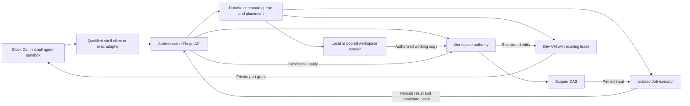

# Agent execution, workspace authority and local mode

Architecture amendment for review · 18 November 2026 · Scope A0–A9

**First release.** A developer opens a stock CLI on their laptop and keeps its native login, terminal and editable worktree there. Each project can select Fly Sprites or Vercel Sandbox for qualified build/test commands. The first release proves that both providers free laptop CPU and return results to that same terminal. Explicitly scoped shims can qualify individual commands. The managed full-shell profile and agent hibernation have separate gates. [Architecture and acceptance](agent-execution.md)

**Recommendation.** Give the agent a durable identity and a replaceable host. Make the queue authoritative for every agent-issued shell invocation in the managed mode, including light commands. Give the workspace one authority over its mutable state. Give a Job a pinned input and a private execution tree. Give a live dev environment an explicit expiry and a private port grant. Use the same public operations for all deployments. The first release should prove this with one stock agent, one local routed command and the network disconnected from every hosted Thegn service; qualify the second stock agent before advertising phase 1.

This RFC proposes an extension to the [Jobs architecture](jobs.md) and [Job contract v0](job-spec-v0.md). It records the design handoff for implementation. Code observations use commit `65081dfd230dbbf7e114ef156541991bdca8472a`; the four in-progress contract crates and their fixtures were also inspected in the working tree. No implementation or performance claim follows from a proposed contract.

**How this differs from Rivet’s published coding-agent examples.** Their Claude Code and Codex guides give each conversation a durable Actor that remembers its sandbox and native session/thread ID. The stock CLI runs in that sandbox. The guides show reconnect and continuation; they do not establish a per-shell-invocation queue that moves commands to an independently priced work fleet. Thegn should implement that additional boundary explicitly. The same user can run the CLI on a laptop today or a small remote sandbox tomorrow while choosing a different worker for each command. [Rivet Claude Code guide](https://rivet.dev/guides/run-claude-code/) · [Rivet Codex guide](https://rivet.dev/guides/run-codex/)

## Existing contracts that shape the design

| Evidence                                                                                                                                                                                                     | Architectural consequence                                                                                                                                                                                                                                                                                                                                      |
| ------------------------------------------------------------------------------------------------------------------------------------------------------------------------------------------------------------ | -------------------------------------------------------------------------------------------------------------------------------------------------------------------------------------------------------------------------------------------------------------------------------------------------------------------------------------------------------------- |
| The control plane already has session attach, input, resize, events and worktree operations. Its protobuf service mirrors an existing control trait; native clients also use HTTP/WS.                        | Publish additive execution resources in a versioned API. Preserve existing routes, capability IDs and attach behavior. A pane's screen snapshot and a workspace's content snapshot need distinct names. [Control protocol](../../crates/thegn-svc/proto/thegn/control/v1/control.proto) · [Capability recipe](../extending/capability.md)                      |
| The closed `Harness` registry already describes launch, homes, account material and optional resume/fork. It includes Codex, Claude, aider, Antigravity and Pi.                                              | Extend that registry. Separate files used for authentication from files permitted in a checkpoint. Gemini CLI and OpenCode need qualification. Preserve existing harness IDs and commands. [Harness source](../../crates/thegn-core/src/harness.rs) · [Harness recipe](../extending/harness.md) · [Existing agent run command](../help/daemon-and-sessions.md) |
| The hibernator already journals capture and destruction, verifies captured state and keeps compute on failure. Its unit of ownership is a worktree-backed provider sandbox.                                  | Share its intent/recovery pattern and verification code. Add per-agent session state, quiescence proof and a fenced wake owner. One agent sleeping must not destroy a host still in use by another workload. [Hibernator](../../crates/thegn-host/src/hibernator.rs) · [Hibernation store](../../crates/thegn-core/src/store/hibernate.rs)                     |
| The v0 job parser accepts `kind: Job`, supports an argv step, and strictly validates fields. The lease contract concerns a worker's right to publish an attempt. The CAS draft defines digest/tree identity. | Use the existing argv and snapshot contracts. Introduce a distinct VM lease resource and gate patch proposals by version/capability. Older clients must still submit and consume ordinary v0 Jobs. [Job contract](job-spec-v0.md) · [In-progress contract change](../../openspec/changes/add-job-contract-v0/proposal.md)                                      |
| Placement, compute accounting, snapshots, proxy metering and sandbox admission have separate responsibilities. The shipped extension wire is subprocess-based.                                               | Reuse placement and the compute ledger. Join model spend by session when observable. Qualify runtime isolation, egress and a future WASM component host independently. [Jobs integration map](jobs.md#starting-point-in-this-checkout) · [Model gateway](model-gateway.md) · [Plugin recipe](../extending/plugin.md)                                           |

Rivet's published agentOS comparison reports **4.8 ms p50** to first code and roughly **22 MB** for a minimal shell workload. Its persistence documentation distinguishes filesystem recovery from process and terminal recovery. Neither measurement establishes a p99 wake time for a stock coding CLI with a restored checkout. Adopt disposable compute and escalation per command. Measure Thegn from user input to a usable resumed session. [Rivet benchmark and methodology](https://rivet.dev/agentos/) · [Rivet persistence and sleep](https://rivet.dev/agentos/docs/persistence/)

## 1. Authority and the public API (A0–A2)

An agent can outlive several hosts. On a laptop all the boxes below can share a machine; each arrow still crosses the same authority or grant boundary.

| Resource  | Identity and owner                                                                | Operations and completion guarantee                                                                                                                                                                                                      |
| --------- | --------------------------------------------------------------------------------- | ---------------------------------------------------------------------------------------------------------------------------------------------------------------------------------------------------------------------------------------- |
| Workspace | Stable ID, owning endpoint and revision; branch and path are labels               | Create, snapshot, diff, fork and sync. A snapshot returns a verified immutable root and capture revision. Sync names its direction, expected base and operation ID. Fork creates a distinct mutable workspace with its own grants.       |
| Blob      | SHA-256 and size under a principal's grant                                        | Has, list-missing, put and get. Verify size/hash, bound batch and stream size, stage uploads and publish atomically. Report availability only within the grant. A digest by itself conveys no read, existence or deduplication rights.   |
| Command   | One durable invocation ID bound to the submitting principal and agent generation  | Submit, watch, input, signal/cancel and result. Return a receipt before execution. Record the selected workspace worker, Job or VM lease and its effects. A client may wait synchronously on this asynchronous resource.                 |
| Job       | Durable submission ID, shard and attempt IDs                                      | Submit, status, stream, cancel and result reuse v0. A durable submit receipt permits lookup after a lost reply. Outputs and optional candidate changes become visible through the winning attempt's fenced commit.                       |
| VM lease  | Resource ID, owner, generation, absolute maximum lifetime                         | Acquire, inspect, renew, release, list/forward authorized ports. Release revokes use and returns a receipt; cleanup state and actual provider termination remain observable. A worker's attempt token cannot renew a VM.                 |
| Agent     | Agent ID, adapter revision, native session ID if known and active host generation | Start, list/status, attach, hibernate and wake. Hibernation returns a checkpoint receipt. Wake can start the correct native session once or return a recoverable failure.                                                                |
| Cache     | Trust domain, workspace/toolchain namespace, key and manifest version             | Grant, restore and save. Execution receives read or staged-write grants. Publish the verified manifest through its proper authority. Agent homes and mutable source have separate retention and grants.                                  |
| Events    | Resource-scoped feed, attempt/generation and resumable cursor                     | Subscribe for output, lifecycle, conflicts and spend. At-least-once records have stable IDs. An expired cursor returns a gap plus a recovery snapshot or log reference. One stream never implies a total order over federated endpoints. |

**One schema and one admission path.** A proposed public `thegn-api` package owns versioned protobuf messages, operation IDs, generated client bindings and compatibility vectors. Keep storage, process management, provider SDKs and transport I/O outside the package. Adapt the existing control trait and catalog to one domain handler per operation. gRPC and HTTP/JSON must agree on presence/defaults, large integer representation, bytes, unknown execution fields, size limits, error reasons and idempotency. A CLI, TUI or MCP tool uses the same authorized operation. A stream can use gRPC, HTTP/WS or a log cursor. MCP can submit, follow or fetch bounded results by reference; large blobs and full-duplex terminals use scoped data streams. Administrative grants do not implicitly become MCP tools. Migrate an existing operation through both façades and run parity tests before changing any incumbent client.

**Authentication and authority.** The local endpoint uses an owner-only Unix socket/runtime directory, peer OS identity where supported, and an automatically issued principal. Give the agent host a restricted endpoint or capability token. Never mount the daemon owner's admin socket into a guest. A VM-local shim can talk to its own Unix socket with a scoped vsock/iroh bridge to the authority. Team/hosted endpoints accept enrolled peers, audience-scoped tokens or OIDC over authenticated encrypted connections. Derive tenant, workspace and session from validated grants. Apply the same isolation, egress, region, cache-write, spend and expiry checks on local and delegated paths. The endpoint exposes supported protocol versions, operations, limits, durability domains and qualified isolation modes.

**Backend contracts.** `BlobStore` verifies immutable bytes and describes the failure domain it can acknowledge. The metadata layer supplies transactions for idempotent submission, epoch/generation comparison, root pinning, event outbox and spend reservations. Keep those operation-specific methods behind a `StateStore` boundary. Raw KV get/put cannot make a lease transition and its publication atomic. Use local filesystem + SQLite + local executor + OS identity first. Team deployments may use a bucket, SQLite with one authority, or Postgres. The hosted service uses distributed pools and durable origin storage. BYOC admission and object grants belong to the enrolled tenant. A local provider may be configured without a bucket if both endpoints can exchange authorized missing blobs and meet required durability. These backends must pass the same state-transition and resource tests.

**Federation.** Give each mutable resource one home authority. Record authority and opaque ID together, bind idempotency keys to principal, operation and content, and resolve subsequent status, cancellation and receipts at that same authority. A laptop can own a workspace and delegate a job by sealing its snapshot, granting the destination only reachable inputs, then asking it to submit. The remote job authority owns its queue, retries and spend receipt. The laptop stores a durable mapping from its request to that remote operation. A timeout triggers lookup with the original key. A destination that cannot be queried leaves the request pending/indeterminate. Copy and verify output objects before promising the destination workspace can use them. Bound delegation depth and reject cycles; each hop can only narrow grants. Only the owning workspace may apply a returned patch. This retains “service as a provider” as a thin remote executor over a common API and permits delegating other resources separately. Portable semantics do not require the OSS daemon and hosted matcher to be one binary or share a database.

**Durability and moving storage.** Report the acknowledged failure domain of a particular root, including local disk, verified independent store, and policy-qualified regional replicas. A write-back cache acknowledgement covers only its present domain. A host slated for destruction must have a verified copy outside that host. To add or remove a bucket, pin roots, copy reachable missing blobs, verify closure at destination and switch metadata references only after a durable receipt. A new laptop also needs a discoverable protected root catalog, workspace/agent identities and recoverable encryption keys. Include them in restore drills. Copying hashes alone cannot restore a user's latest checkpoint. Release pins on deletion/expiry and trace remaining references during GC. Account for unreferenced staging bytes and interrupted uploads.

## 2. Routing a stock command (A2–A3)

The stock CLI owns the model loop. Its shell tool sends each invocation to the durable **Commands** API. The daemon assigns it to a worker, which owns the subprocess. A laptop can put the CLI, queue and worker on the same physical machine. A cloud installation can put them on three differently priced resources. The scheduler separates **recording a command** from **starting an expensive machine**.

| Worker selection                   | Eligibility                                                                                                                | Execution contract                                                                                                                                                                                                                                                                                         |
| ---------------------------------- | -------------------------------------------------------------------------------------------------------------------------- | ---------------------------------------------------------------------------------------------------------------------------------------------------------------------------------------------------------------------------------------------------------------------------------------------------------- |
| Workspace worker                   | Version/help, searches, `git status`, formatters, arbitrary shell that requires the live checkout and is allowed by policy | Commit the command row before dispatch. Wake an already enrolled local or nearby workspace worker over a persistent connection. Execute within the authorized working copy, preserving cwd and output. A laptop uses SQLite and a local socket; it does not upload the tree for a two-millisecond command. |
| Snapshot Job                       | Qualified builds, tests and other bounded commands whose inputs, environment, outputs and effect policy are known          | Pin the snapshot once. Convert the whole shell or argv invocation into one Job with a link back to the command receipt. Placement can choose local, warm remote, or spot when replay is permitted.                                                                                                         |
| Dedicated adapter                  | Nix builds or qualified nextest/Playwright shard recipes                                                                   | Admit the parent command first. Nix may delegate builds through its native builder protocol. Sharding requires a known partition convention and result aggregation.                                                                                                                                        |
| Live VM lease                      | Explicitly profiled dev server, browser, DB or debugger                                                                    | A queued command obtains/uses the scoped lease. Foreground attach, readiness, detach, TTL and port grants retain their usual meanings.                                                                                                                                                                     |
| Location- or side-effect-dependent | Unknown package scripts, GUI, local services, publishing, inherited descriptors or mutable host state                      | Select an authorized worker that provides the required semantics, or record a refusal. Unknown syntax never justifies an automatic replay or silently running inside the CLI sandbox.                                                                                                                      |

**What “all” covers.** The queue unit is **one invocation of the harness's shell/exec tool**. For `cd crates/app && cargo test | tee result.log`, send the original shell program and its dialect to one worker. It owns the process group, pipeline, redirection, built-ins, signals and exit behavior. A standalone argv call preserves its argv vector. Spawning the compiler's own subprocesses does not create recursive queue entries. The CLI's internal runtime, model HTTP calls and native file tools are different interfaces. Route native file operations through the authorized workspace view where supported. If a harness writes with a built-in edit tool, the next queued `git diff` must see that edit. Before dispatch, require a workspace revision acknowledged by the worker, or keep both working views under the same authority. No shell command reads from an asynchronously lagging S3 mirror by accident.

**Where the files live.** The agent and work fleet share authorized S3-compatible **objects** when they are on different machines. They need not share a writable filesystem or a bucket key. A workspace worker has the materialized checkout and the Git metadata needed by commands such as `git status`. A snapshot worker receives an immutable root, scoped cache/artifact grants and a private output overlay. Keep a live revision fence for interactive workspace commands and force an acknowledged sync after native harness file edits before a different worker can run dependent shell. Reuse a hot checkout when possible. A command needing unpushed refs, a local socket or an uncommitted file must advertise and obtain that capability or refuse placement. A hosted CLI needs an outbound connection to the queue and its own scoped workspace view; it does not need the compiler, Docker socket or blanket bucket credentials.

**Stock harness qualification.** Prefer an officially configurable shell/exec delegate. A managed launch may instead supply a trusted shell front end at the precise executable path that a pinned harness invokes, with a narrow authenticated transport and a separate real shell on the worker. Instrument and test interactive and headless launches independently. A PATH shim for `cargo` cannot intercept a shell built-in, an absolute path, a bundled shell or a separate exec tool. PATH shims remain a compatibility option for selective routing in a visibly different, weaker profile. To advertise all-commands mode, every shell/exec entry point of the advertised harness version must delegate or be denied by the actual host sandbox. Deny unsupported versions for that mode. Preserve existing unmanaged Thegn launch behavior. Do not remotely execute the CLI's startup, helper or auth processes accidentally.

**Placement grammar.** Use parsed features or an explicit recipe to pick a more capable worker. Plan opaque shell programs as a unit on a compatible workspace worker. Carry cwd, shell/dialect, umask, environment allowlist, stdio/TTY mode, input cursor and deadlines. A long-lived interactive shell whose next command depends on a prior `cd`, shell function or job-control state requires a pinned shell-session handle. A host loss ends uncheckpointable shell state with an explicit interruption. Match isolation and real egress/credential grants on every lane. The queue is an execution boundary only for qualified captures; authorization remains structural.

**Defaults and inference.** In all-commands mode, default installations queue all invocations and choose the laptop workspace worker for ordinary shell, or a locally placed Job for qualified build/test recipes. Treat `auto` as permission to choose among qualified executors and `remote`/`--remote` as an explicit remote requirement. A user wanting “prefer remote but allow local” selects `auto` with that preference. The repo may select or narrow admitted recipes; only a trusted profile may enable destinations, increase spend, broaden write-back or relax a hard constraint. Estimate queue, wake, data transfer, cache hydration, execution and return time against local load and headroom. Pin the chosen image digest or Nix closure and native platform/arch at admission. Use a permitted explicit rule environment first; then a permitted repo-declared environment; then compatible tool-specific pins such as `rust-toolchain.toml`, lockfile, `.nvmrc`, `.tool-versions` or a selected flake. Neither a lockfile nor a language version specifies a complete OS image. Apply documented per-tool mappings and reject conflicting pins or an unknown environment. Explain the chosen recipe, inputs, destination and fallback before spending money.

**Shim protocol.** A small versioned route client sends an authenticated invocation ID, workspace capability, cwd relative to its root, argv as discrete values, permitted env names/values, stdio/TTY mode, deadline and optional expected workspace revision. For Unix byte strings either define bytes wire fields or explicitly reject unsupported non-UTF-8 values before routing. The authority owns snapshot capture and validates cwd, env, source authority and user intent; a shim-provided digest is a hint. Execute explicit argv without re-parsing. A shell-tool request carries the original program to the worker, where the shell interprets redirection, globbing and pipelines. A legacy per-tool shim sees only the argv for its own process. Support only the file descriptors and stream semantics negotiated for the remote command. Use the same route command internally for CLI, shims and MCP; preserve existing `thegn agent run` behavior when adding any `thegn agent <name>` shorthand.

| Exchange            | Required behavior                                                                                                                                                                                                                                                                                                                                                                                                                                                                              |
| ------------------- | ---------------------------------------------------------------------------------------------------------------------------------------------------------------------------------------------------------------------------------------------------------------------------------------------------------------------------------------------------------------------------------------------------------------------------------------------------------------------------------------------- |
| Admit → accepted    | Persist the command and return a stable ID, followed by a worker/Job/lease assignment or refusal. Lookup by original scoped invocation key if acknowledgement is lost. Enforce deadlines and limits before staging unbounded data.                                                                                                                                                                                                                                                             |
| Attach and I/O      | Pipes preserve bytes, original stdout/stderr channels and per-channel ordering. Carry stdin chunks, backpressure, EOF, broken pipe and disconnect. A real PTY carries one combined byte stream, initial size, resize and supported foreground signals. Separate streams, exact timing and terminal emulation cannot all be promised at once.                                                                                                                                                   |
| Cancel and terminal | Ctrl-C forwards the negotiated signal or invokes cancellation. Report the winning outcome when exit races cancel. Return the process code or documented signal convention, with a separate structured reason for submit/sync/transport failure. Preserve the process exit even when sync fails; the shim then exits non-zero.                                                                                                                                                                  |
| Retry and fallback  | A replay-safe attempt may transparently restart before externally visible output or other effects. Once bytes have reached a pipe/TTY, default to a surfaced interruption and an inspectable attempt history. An explicit attempt-aware client can opt in to following a retry. Put restart markers on its control/event channel; adding text to stdout or stderr corrupts machine-readable output. After ambiguous dispatch, reconnect by ID; never execute a second local copy on guesswork. |
| Daemon down         | All-commands mode requires a durable command authority. With an unavailable queue, the shell client reports unavailability. When a remote worker disappears, the same authority may assign the original command to a qualified local worker only after establishing safe replay and all constraints. Report unavailable when budgets, location or fate cannot be established.                                                                                                                  |

The native launch adapter may install per-session MCP configuration and observation/deny hooks. Codex documents `PreToolUse` for shell, patch, MCP and other local functions; coverage varies by tool. Neither Codex nor Claude needs to rewrite shell calls for this design. Confirm behavior against pinned shipping harness versions. Route model requests through the gateway when configured and supported. Broker registry/git operations using scoped credentials. A local stock login can have its own supported path; subscription spend is observable only where the harness supplies suitable evidence. [OpenAI Codex hooks](https://developers.openai.com/codex/hooks/) · [Gateway architecture](model-gateway.md)

## 3. Workspace snapshots and source changes (A4)

The canonical input is the current workspace tree, including allowed dirty and untracked files, executable bits and bounded symlinks. Keep Git identity and parent/branch metadata for restore or fork separately from the tree digest. Use a real local filesystem for editors and language servers. A remote checkout may hydrate lazily if reads, enumeration, deletes, rename and watcher behavior meet the same contract. A daemon-owned mirror or cached tree index can accelerate capture; a watcher notification alone cannot prove the tree was stable. Capture consistently from a filesystem snapshot or a coordinated workspace revision. Detect concurrent changes on ordinary worktrees and retry/refuse on uncertainty. On unsupported filesystems or uncooperative writers where a consistent cut cannot be proved, require a quiesced or explicitly selected immutable snapshot for operations promising that guarantee.

A Job mounts its base read-only and writes to an isolated overlay/scratch tree. A reflink or copy-on-write mount is suitable where supported. Never hard-link mutable worktree or guest-writable files to immutable CAS blobs. Use a verified copy otherwise. Cache roots and artifacts are mounted or collected separately. Caches use a trust domain, workspace, platform, toolchain and relevant build settings in their key; a warm match is a scheduling preference. Keep executors private per run even when hosts or read-only layers stay warm.

**Patch protocol.** Ordinary explicit Jobs retain artifact-only behavior. A capability-qualified routed run may also publish a `SourcePatch` candidate. Include workspace ID, base revision/root, job/shard/run/epoch, relative path changes with before/after digests or tombstones, executable mode, manifest digest and requested sync policy. Publish through the same winning attempt commit as artifacts. Only the workspace authority can accept it. The worker has neither a worktree write grant nor a path back to the laptop.

1. For `none`, return the result and references only. For `source`, use a rule's **declared allowed source outputs**, subject to higher-level protected paths. “Everything outside a cache” is too broad to grant to a build script. Formatters, lockfile updates, generated source and snapshot-test updates can each get an explicit rule. Offer other candidates for inspection. For `all`, require an explicit trusted grant and bounded paths/bytes. It still excludes Git administration, agent home, secrets, caches, declared artifacts and prohibited destinations. Use explicit artifact retrieval for large outputs.
2. Validate candidate scope, current authorization, receipt, path normalization, symlinks, mode and types at apply time. Bound total files/bytes. Detect case collisions, unsupported filenames, binary conflicts and out-of-tree links before writing. Retain provenance on remotely generated source. For sharded tests, default to no source write-back. Permit an explicitly nominated writer or a deterministic disjoint merge with collision rejection.
3. Compare base, current workspace and proposed tree. Stage a complete three-way result. If any path conflicts, leave the live workspace untouched, retain the candidate and report paths and recovery handle. Preserve the subprocess exit plus a distinct sync result. A tool returning non-zero can still have legitimate snapshot updates; collect candidates on ordinary exit according to the rule. On cancel, invalid epoch or ambiguous completion require explicit inspection; no automatic source publication.
4. Under an authority that can exclude **all** destination writers, journal the expected revision and candidate ID, conditionally publish the staged result, and issue one apply receipt. Replaying a lost receipt cannot apply twice. Fence simultaneous jobs and check the expected revision again at publication. Plain Git worktrees permit independent editors and processes; a daemon mutex or a multi-file rename loop cannot make them transactional. On such a worktree the first release should default to reviewable patch output or a queued workspace-worker invocation for commands that require immediate source mutation. Enable automatic apply only after proving the write barrier, crash recovery and preservation of concurrent edits for that workspace mode.

**Observable limits.** A test that only emits stdout and a JUnit artifact can be transparent. A build followed by `./target/debug/tool` expects a local executable. A subsequent script may likewise expect `node_modules` or a generated source file. Keeping outputs remote breaks those workflows unless the dependent stage runs in the same declared environment or the caller explicitly retrieves/materializes permitted outputs. Qualify read-mostly test recipes first. Keep builds with downstream local output consumers, arbitrary scripts, lockfile writers and installers on the queued workspace worker or explicitly routed with a documented contract. A shim cannot infer a future shell command from the present argv.

**Example.** A snapshot-test updater starts on workspace revision 41 with permission to propose changes under `tests/snapshots/`. While it runs, the user edits one expected-output file and an unrelated source file. The worker commits a candidate containing two updated expectations; the second expectation conflicts. The command's process exit is 0. The workspace operation returns `conflict`, both user edits survive, neither expectation is silently applied, and the shim returns a documented non-zero status. The owner can inspect the base/current/proposed files and explicitly apply a resolved candidate against revision 42. Reopening the original Job still shows its original input and successful process exit.

## 4. Agent checkpoints and VM leases (A5)

The [stock CLI hibernation experiment](agent-execution.md#experiment-hibernate-a-stock-cli-between-turns) qualifies Claude Code and Codex per launch mode. It compares native session restart with a whole-VM cache on dedicated guests and records the three terminal-session projects that informed the design. [Low-priority experiment](https://linear.app/example/issue/THE-2420)

**The durable unit is a session.** An agent record binds owner, workspace, harness and immutable adapter version, native session ID, compatible environment/checkout path, session generation and current active host if any. A portable checkpoint is a versioned manifest storing scoped references to an adapter-approved home tree, workspace snapshot, Git restoration metadata, expected workspace revision, applicable retention policy, checkpoint generation, and named references for reissuing runtime credentials. Include lease IDs and their retention choices for reconciliation. Environment persistence uses an allowlist of non-secret values. Exclude auth databases, keychains, live socket paths, cloud tokens, inherited environment and unapproved transcript content. Keep the home private per principal/agent, encrypted under its trust domain. If permitted resumable history cannot be safely separated from protected data, advertise that adapter/profile as unable to hibernate. Distinguish disk persistence, public manifest encoding and the private, authorized lookup of that manifest.

| Transition                    | Required proof and recovery                                                                                                                                                                                                                                                                                                                                                                                                                                                                                                                                                 |
| ----------------------------- | --------------------------------------------------------------------------------------------------------------------------------------------------------------------------------------------------------------------------------------------------------------------------------------------------------------------------------------------------------------------------------------------------------------------------------------------------------------------------------------------------------------------------------------------------------------------------- |
| Active → quiescing            | Recognized between-turn boundary, no active model/tool/input stream, foreground process, pending approval that cannot survive restart, or unknown child activity. Check running jobs, attaches and lease policy. Acquire an exclusive agent-generation transition. Five idle minutes remotely is a candidate trigger, never proof. Local automatic sleep starts disabled.                                                                                                                                                                                                   |
| Quiescing → checkpointed      | Fence new turns; queue input durably. Ask the adapter to flush and stop cleanly. Capture consistent state, including SQLite backup/checkpoint semantics when applicable. Verify every reachable blob at the required durability and pin the manifest before committing the new generation. A failed capture retains recoverable host/state, releases or reconciles the intent and reports a reason.                                                                                                                                                                         |
| Checkpointed → sleeping       | Persist host-release intent, revoke old run grants, close tunnels as required, release compute idempotently and reconcile the provider's actual state. An independent/shared host releases only this tenancy/placement. Single-use tenant guests are destroyed. Only clean, unused templates can join a warm pool.                                                                                                                                                                                                                                                          |
| Sleeping → restoring → active | Gate concurrent wake calls by agent/generation; allocate at most one active writer. Restore workspace and sanitized home at a compatible logical path. If the laptop workspace advanced, reconcile against the recorded base or fork the saved revision; never overwrite intervening edits. Issue fresh credentials, invoke the pinned native resume operation, verify the expected session is ready and deliver queued input with its ID. A lost reply recovers the active handle. An ambiguous user-turn delivery must be surfaced unless the adapter proves idempotence. |
| Restore failure               | Keep the manifest and explicit reason: missing durable object, unavailable credential, incompatible harness, location mismatch or failed readiness. Permit recovery/fork by the owner. Opening a fresh conversation requires an explicit choice.                                                                                                                                                                                                                                                                                                                            |

The adapter qualification matrix must distinguish interactive launch, headless launch, scoped authentication, stable native ID capture, graceful stop, positive between-turn detection, interactive resume and headless resume. Claude Code and Codex expose native resume operations; shipping those commands does not establish portability across hosts or versions. Test each supported mode on an empty second host, including working directory relocation and session format changes. Aider and Pi can initially advertise fewer capabilities. Gemini CLI and OpenCode need versioned fixtures. A generic adapter may use an explicitly owner-registered executable and advertise selective PATH routing only. Full-queue mode requires the separate capture qualification. A repository cannot install an arbitrary executable by declaring a new harness ID. Reuse the closed `Harness` source of vendor facts; publish a data-only descriptor crate if a second consumer needs it. [Claude CLI reference](https://code.claude.com/docs/en/cli-reference) · [Codex CLI reference](https://developers.openai.com/codex/cli/reference/) · [Harness qualification recipe](../extending/harness.md)

**Idle and lease policy.** An attached foreground user, active turn, unknown state or blocking job vetoes automatic hibernate. For an agent-owned VM lease, record one policy: keep the agent awake while attached, release on sleep, or detach and pin until a separately authorized TTL. An explicit sleep may release a release-on-sleep lease and wait for confirmation. A detached, pinned lease continues accruing cost independently and appears on the user's dashboard. Never destroy a dev server solely because a pane has shown no output. A host is disposable only after any promised state has been acknowledged outside the host.

**VM lease contract.** Keep `kind: Job` in v0. Introduce a sibling `VmLeaseSpec` and `VmLeaseStatus` with shared execution requirements for snapshot, environment, resources, isolation, placement, grants and accounting. A future versioned envelope may discriminate run vs lease. A lease additionally requires TTL, hard deadline, readiness policy, allowed activity/renewers, port specifications, edit-follow mode and close behavior. A dev server has ongoing health, input and ports; a bounded Job has a terminal `JobResult`. Each can still use the same scheduler, host agents and fenced attempts internally. Never put a client VM TTL or port grant in the worker heartbeat token.

The lease state machine is requested → allocating → ready → draining → released/expired, with failed/lost and cleanup-pending outcomes. Persist request intent before provisioning. Each successful replace/allocate uses a new generation. Only the lease authority renews from an authenticated request or qualified user activity, bounded by absolute deadline and budget. Tunnel keepalives alone do not extend billed life. Expiry/cancel revokes ports, workspace streams, secrets and writes even if the provider is unreachable. Reconcile orphan compute and record actual stop or unresolved billing. Default live state is unrecoverable on spot reclaim. A replacement is an explicit new generation requiring reconnect and readiness; recovery promises require the workload's own persisted state.

**Ports and edits.** Declare protocol, port, principal and exposure before forwarding. Reserve the agent's loopback port in its private namespace or return a different endpoint explicitly; never attach to or evict an unrelated listener. Scope the private tunnel to lease ID, generation, destination and TTL. On disconnect, revoke or rebind following authenticated generation checks. Initial sync is workspace → VM only. Send numbered changes with base/result roots, deletes and renames; coalesce bursts, verify applied revision and report lag. On a gap resnapshot, then resume after the acknowledged cursor. Keep VM runtime data outside followed source roots. Explicit pull generates a reviewed candidate patch through the workspace protocol. An imported database or a browser profile is a separately authorized artifact. A foreground `npm run dev` returns when the server exits; it cannot also return immediately with a usable background server unless the caller requested detach.

## 5. Local ladder, security and cost (A6)

| Deployment                                          | What a user can rely on                                                                                                                                                                                                                                                                                                                                                                                                                                                                                                                                  |
| --------------------------------------------------- | -------------------------------------------------------------------------------------------------------------------------------------------------------------------------------------------------------------------------------------------------------------------------------------------------------------------------------------------------------------------------------------------------------------------------------------------------------------------------------------------------------------------------------------------------------- |
| Clean laptop                                        | Thegn initializes owner-scoped metadata and CAS under the platform data directory (XDG data home on Linux), negotiates actual local backends and uses the existing authentication path for the installed harness. Zero Thegn configuration presumes a supported harness, toolchain/image and policy-capable sandbox are available. Offline fixtures require neither a provider account nor a network. Real model use still requires a usable model/auth path. Ordinary Thegn shell launch remains independent of Jobs and of the optional model gateway. |
| Add a bucket                                        | Authorize a bucket/prefix, retention, encryption and recovery-key custody. Push missing blobs and protected root inventory, verify a new-machine restore, then advertise remote durability. Cache write rights and hibernated-home read rights differ.                                                                                                                                                                                                                                                                                                   |
| Add one provider                                    | Bind a project’s approved build/test recipes to Sprites or Vercel Sandbox. Transfer inputs directly from local CAS and keep the agent local. A bucket is optional. A remote-required recipe reports an unavailable provider or missing permission and keeps CPU-heavy work off the laptop.                                                                                                                                                                                                                                                               |
| Add more providers, team endpoint or hosted service | Same operations and result format. Placement may shard qualified tests. Remote agent checkpointing, VM leases and private ports require their respective advertised capabilities. Login is needed only for endpoints that require it.                                                                                                                                                                                                                                                                                                                    |

On Linux, bwrap is an option for a qualified trusted agent-host profile. A script, including a “light” one, can execute arbitrary code; an agent-authored or external workload inherits the applicable VM floor. Under that policy the agent execution domain itself needs a qualified boundary wherever it can execute that code. Eligible local Jobs can use a proven container or VM according to their trust floor. If KVM, a usable image or a qualified runtime is missing, explain the unmet capability and eligible alternatives. On macOS, an Apple Virtualization.framework guest is a proposed path to qualify. Verify image availability, file sharing, filesystem semantics, egress and independence of the agent and Job before claiming local parity. Sharing an existing VM only works within an admitted trust domain, with private mounts, process and credential separation appropriate to the workload. Native Xcode requires explicit, trusted host-mode opt-in above the repo layer. Owner-authorized `none` remains a visibly uncontained option for eligible trusted work. A timeout or provider outage cannot relax these decisions.

Use three different accounting identities: agent residence (awake, idle or sleeping), each job attempt and each live VM lease generation. Attribute model usage through the gateway or supported independent observations. Join by verified session/workspace without reposting the same provider charge. A pinned VM, retained volume, warm pool, replication or outbound transfer can still cost money while the agent sleeps. Report amounts as observed, estimated or unknown. Record the policy and actual enforcement backend. For hosted tenants, qualify hardware isolation for agent hosts as well as heavy jobs, deny ambient credentials and avoid cross-tenant guest reuse. Route egress by sandbox policy and broker grant; a shim or harness hook cannot enforce that boundary.

## 6. Three acceptance journeys (A7)

| Journey                               | Success assertions                                                                                                                                                                                                                                                   | Failure assertions                                                                                                                                                                                                                                                          |
| ------------------------------------- | -------------------------------------------------------------------------------------------------------------------------------------------------------------------------------------------------------------------------------------------------------------------- | --------------------------------------------------------------------------------------------------------------------------------------------------------------------------------------------------------------------------------------------------------------------------- |
| Local terminal → project runner       | One qualified local stock CLI runs a failing test, edits locally and reruns. Project A uses Sprites. Project B uses Vercel Sandbox. Record the pinned root, correct exit, artifact, warm/cold latency and local CPU-seconds against direct local execution.          | Disconnect the viewer, cancel the build, race a local edit and remove provider availability. Verify one authoritative result, isolated outputs, bounded cleanup and no local heavy process.                                                                                 |
| Remote Codex → sleep → morning review | Track an overnight test as independent shards, then reach a verified turn boundary. Capture permitted session state, release the host and restore on a different host. A user attaching to the recovered native session can see and review the original dirty edits. | Revoke a credential, remove a checkpoint object, send input during capture, and race two wakes. Verify no secret was persisted, no wrong session opened, and at most one writer received the new grant.                                                                     |
| Agent → dev server plus browser       | Allocate a private VM lease, wait for readiness, reach the assigned port only from the authorized agent and observe an acknowledged workspace edit triggering hot reload. A pinned lease can outlive its sleeping agent inside its authorized budget.                | Occupy the desired loopback port, drop an edit event and race TTL expiry with renewal. Verify explicit port selection/refusal, resnapshot on a gap and tunnel revocation for the retired generation. Release/cost state remains inspectable after a failed provider delete. |

## 7. Contract and delivery handoff (A8–A9)

| Surface                      | Proposed change and compatibility gate                                                                                                                                                                                                                                                                                                                                                                                                                                                                                                                               |
| ---------------------------- | -------------------------------------------------------------------------------------------------------------------------------------------------------------------------------------------------------------------------------------------------------------------------------------------------------------------------------------------------------------------------------------------------------------------------------------------------------------------------------------------------------------------------------------------------------------------- |
| Public API and conformance   | Add versioned operations, authority-qualified resource handles, scoped idempotency, durability receipts, reason codes and event cursors. Cross-check the old control service and new API on shared operations. Run identical behavioral vectors against local SQLite/directory, a team endpoint with Postgres/bucket, and a hosted/BYOC deployment. Explicitly required unsupported capabilities fail before placement. Include schema downgrade and offline tests.                                                                                                  |
| Job/guest protocol           | Keep v0 `kind: Job`, required steps, fenced commit and artifact-only explicit defaults. Carry verified `origin` in admission metadata. Propose capability-negotiated patch refs and sync outcomes in an opt-in routed result/envelope; scope `syncBack` at the workspace consumer. Introduce a new API/spec revision where strict old readers reject a field. Submit plain v0 to older providers only when it can honor the full request. Release cross-version vectors before new writers.                                                                          |
| CAS and checkpoint manifests | Keep digest/tree encoding interoperable. Define versioned manifest payloads for patch and checkpoint; put their typed meaning, grants and lifecycle in the owning API/domain. Add per-root reachability, durable pins, reissued grants, conditional publication, migration and deletion fixtures.                                                                                                                                                                                                                                                                    |
| Agent and shim adapters      | Extend the single registry with state allowlists, quiescence/resume evidence and mode-specific capabilities. Define a bounded, versioned shim stream with control and payload frames. Test normal CLI/TTY, pipe, scripted and MCP entry points without installing hooks. Preflight packaging, executable lookup, recursive invocation and stable logical paths.                                                                                                                                                                                                      |
| Live leases and operator     | Share execution requirements and attempt fencing; qualify separate lease resource state, clock, port policy and cleanup reconciliation. A service agent-host template is a clean single-tenant guest. Size pools by measured concurrency and queued wakes, then test disruption with pending captures and pinned leases.                                                                                                                                                                                                                                             |
| Native agents, phase 4       | Proposed Wasmtime component world for Thegn-owned or explicitly trusted tenant-scoped agents. Grant workspace read/write, bounded jobs/leases, gateway calls, KV, clock and brokered HTTP independently. No ambient filesystem, network or secrets. Persist versioned state plus input cursor/output-intent receipts per event, reclaim idle instances, and deduplicate delivery after a crash. A JS/V8 host needs separate demand and qualification. Preserve the service VM floor for untrusted tenant work. A WASM runtime is new delivery work in this checkout. |

| Phase and dependency                                                                                                                                                                                                                     | Exit evidence                                                                                                                                                                                                                                                                                                                                  |
| ---------------------------------------------------------------------------------------------------------------------------------------------------------------------------------------------------------------------------------------- | ---------------------------------------------------------------------------------------------------------------------------------------------------------------------------------------------------------------------------------------------------------------------------------------------------------------------------------------------- |
| **1 · Local terminal, remote build/test.** Use the local daemon and one qualified stock CLI with a project-selected Sprites or Vercel Sandbox runner. Ship one measured build/test path on each.                                         | An uncommitted edit is visible remotely, terminal output and exit are faithful, and local CPU falls. Verify cancel, disconnect and provider refusal. Grade the automatic shell path by harness, OS and recipe. [Cross-provider gate](https://linear.app/example/issue/THE-2419)                                                                |
| **2 · Portable OSS.** After terminal offload, qualify offline stock/durable execution and portable state. Add SSH/Fly qualification, checkpoint/restore, VM leasing, port binding and one-way edit sync. Expand adapters per capability. | Run the three journeys. Move a workspace to a bucket and recover using a clean daemon. Fail a capture before destruction, duplicate wake, expire a lease under partition and compare warm/cold build results. Publish support matrix by harness version, platform, routing grammar and durability.                                             |
| **3 · Hosted and BYOC.** Depend on published contract versions and cross-backend conformance. Add clean agent-host pools, scoped delegated auth, origin durability and independent queue/compute recovery.                               | Route local workspace → hosted Job and resume a remote agent after losing its pool. Test isolation and grants across two tenants, stale token/epoch refusal, scoped blob lookup and verified output durability. Verify one billable lineage per actual allocation.                                                                             |
| **4 · Qualified acceleration.** Gate memory snapshots and native agent runtime separately on observed latency, cost or demand.                                                                                                           | For VM snapshots record VMM/CPU/kernel/image compatibility, secret/memory custody, fresh entropy/credentials and fenced restore. Measure portable restore as fallback. Never clone one live credential-bearing process into concurrent writers. For native agents test capability denial and crash/resume with an outstanding external action. |

### Decisions on the eight open questions

1. **Capture and placement coverage.** Queue every shell invocation for a qualified harness. Start with a narrow offload grammar for tested, read-mostly commands. Qualify additional forms separately, including flags, stdio, artifact dependencies and effects. Treat scripts, GUI, service dependencies and commands with externally visible writes as opt-in. Keep an explicit CLI/MCP path.
2. **Toolchain conflicts.** Follow permitted explicit rule → declared repo environment → compatible per-tool inference. Refuse ambiguous pins, platform mismatches and insufficient environments. Record the image/closure and all resolution inputs in the result.
3. **Sync conflicts.** Stage the whole patch; surface a conflict and non-zero shim result without partially updating the checkout. Return the original command outcome, conflict paths and a durable review/retry handle.
4. **Remote credentials.** Prefer brokered, short-lived, reissuable credentials. An adapter that requires an unsupported login is local-only or requires an explicitly approved remote authentication flow. Exclude raw logins from portable homes and snapshot images by default.
5. **Sleep boundary.** Only between positively established turns after quiescing barriers. An agent blocked on an unfinished tool or model call remains awake. A future detached job may survive sleep only with a separately proven continuation and completion-delivery contract.
6. **Wake target and pool size.** Evaluate the proposed under-three-second target as p95 from input acceptance to a verified attachable native session for a declared warm template and home/workspace-size cohort. Record queue, claim, hydration, auth and harness-ready time plus p50/p95/p99, misses and cost. Measure interactive demand and service capacity at burst/failover before setting a standby floor. Keep cold start and large-home measurements visible.
7. **VM sync direction.** Workspace → VM with revisioned acknowledgements; explicit, reviewed pull for VM edits. Measure the proposed sub-second edit-to-observed-reload target under a stated working-set size, network and watcher workload.
8. **Hooks.** Observation and deny decisions where available. A verified hook may improve idle detection; absent hooks lower adapter capabilities. Prove shell/exec capture independently of hooks for the full-queue profile; expose selective PATH routing as a separate capability.

**Implementation handoff.** The existing issue for one-call agent execution is the integration point for stock launch; its current CLI behavior has users. Coordinate workspace apply with the parity work, checkpoint recovery with the hibernator, delegated placement with remote-daemon work, and enforced egress with the gateway qualification. These issues own related surfaces; the amendment proposes additional scope. Before a runtime change, attach the relevant phase slice and conformance vectors to its owning issue/worktree and add an OpenSpec delta. The first implementation review should decide which local workspace mode can actually enforce the write barrier and which installed backends qualify the intended default trust profile. Both require runtime evidence. [Agent launcher](https://linear.app/example/issue/THE-2005) · [Workspace parity](https://linear.app/example/issue/THE-446) · [Hibernation durability](https://linear.app/example/issue/THE-442) · [Attached-session guard](https://linear.app/example/issue/THE-1518) · [Remote-daemon contracts](https://linear.app/example/issue/THE-2107) · [Gateway egress qualification](https://linear.app/example/issue/THE-2255)

## 8. Keeping an idle cloud agent cheap

The product target is **zero dedicated agent compute while a session is safely asleep**. A sleeping agent is a database record, a checkpoint or local workspace reference, and a way to receive its next event. It occupies no per-agent VM, container, resident process, websocket worker or polling loop. A shared dispatcher still has a bill. A stock CLI needs CPU and resident memory when it is actually handling a turn. A build worker has an independently measured lifetime. Rivet's deployment and pricing docs distinguish the control plane, supplied nodes and storage. Use those distinctions when reporting Thegn costs. [Rivet architecture](https://rivet.dev/docs/architecture/) · [Deployment models](https://rivet.dev/docs/deploy/) · [Rivet pricing](https://rivet.dev/pricing/)

### What stays awake for each kind of work

| Developer activity                                                          | Agent runtime                                                                                                                                                       | Work runtime                                                                    | What the developer experiences                                                                                                                                  |
| --------------------------------------------------------------------------- | ------------------------------------------------------------------------------------------------------------------------------------------------------------------- | ------------------------------------------------------------------------------- | --------------------------------------------------------------------------------------------------------------------------------------------------------------- |
| Edit in an existing laptop worktree, open a diff or inspect a completed run | The stock CLI can stay closed. The local daemon serves metadata on demand.                                                                                          | None                                                                            | Git, editor and terminal operate on local files. Opening an old result or tailing retained logs does not wake an agent.                                         |
| Ask the stock CLI a question                                                | Prefer the installed local CLI when the user's selected location, credentials and policy permit. A remote session acquires a small compatible runner for that turn. | None until a command needs it                                                   | First-party harness behavior, live PTY and a nearby queued workspace worker for light commands. Model time and model usage are visible separately from compute. |
| Run a qualified build/test                                                  | The local CLI may block on its shim without renting agent compute. A remote stock CLI that has an outstanding blocking tool call keeps its small runner.            | One admitted Job or independent shards; terminate or release after finalization | Same invocation, inspectable Job ID, live streams, result and cancellation. Warm caches may survive independent of the worker.                                  |
| Wait for review between completed turns                                     | No runner after a verified checkpoint. A shared endpoint can durably accept comments or a wake signal.                                                              | None unless the user pinned a service                                           | The diff and last result remain immediately inspectable. A user can explicitly wake the same session or fork it for another experiment.                         |
| Wait on a Job or approval in an agent Thegn controls                        | Persist the continuation, expected event and idempotency key; unload the native runner. Qualify a stock adapter separately before granting this ability.            | Only the Job, while work remains                                                | A completion or decision reactivates one continuation. Retried notifications cannot execute the same action twice.                                              |
| Use a dev server, browser or debugger                                       | Wake only if the agent is asked to act                                                                                                                              | Explicit VM lease with readiness, TTL, private ports and budget                 | The user can inspect or release the service independently of the conversation. The UI shows accrued cost while it remains pinned.                               |

**A cheap first deployment.** A laptop-only user pays no cloud runner fee to Thegn. The first cloud addition for an individual is **a project-selected Sprites or Vercel Sandbox runner**, while the CLI, worktree, session history, queue authority and fast workspace worker stay on the laptop. That delivers elastic compute with no remotely resident agent. A small team can run the control endpoint on an existing machine, reuse enrolled outbound-connected workers and add cold capacity when needed. An agent that must take webhooks overnight while all laptops are offline needs a reachable shared ingress, durable inbox and wake dispatcher. Qualify either an existing team server or an on-demand ingress/queue consumer with persistent state, idempotent dispatch and a restartable provisioning path. A scheduled platform wake or shared timer can wake the queue; there is no timer process per sleeper. Pure laptop mode queues only events the laptop actually receives. Before parking the last worker, prove the wake path does not itself depend on that worker. [Rivet nodes](https://rivet.dev/docs/nodes/) · [Pool configuration](https://rivet.dev/docs/pool-configuration/) · [Scheduling](https://rivet.dev/actors/docs/schedule/)

A hosted fleet may pack active, independently sandboxed agent hosts on shared capacity. A single instance that stops billing only after a provider-specific grace or minimum charge needs its own measurement. Choose cold-start-by-default or a shared warm buffer per installation/SLO; never preallocate one warm VM per dormant agent. Keep cache storage and provider-side volumes observable after scale-down. If active concurrency makes a small standing node cheaper than repeated cold activations, the planner can switch supply without changing the API. Spot is suitable only for replay-safe Jobs with recoverable inputs. Preserve the stricter policy for interactive leases or external effects.

### Picking the agent sandbox separately from the work fleet

| Candidate            | What to qualify for the stock agent                                                                                                                                                                                                                          | Bill to measure                                                                                                                                                                                                                                                                            |
| -------------------- | ------------------------------------------------------------------------------------------------------------------------------------------------------------------------------------------------------------------------------------------------------------ | ------------------------------------------------------------------------------------------------------------------------------------------------------------------------------------------------------------------------------------------------------------------------------------------ |
| Local sandbox        | Exact installed harness, interactive and headless shell delegation, credential broker, supported local filesystem and required trust boundary. An attached local worker consumes the same command contract.                                                  | Local CPU/memory, optional model usage and any chosen remote Jobs.                                                                                                                                                                                                                         |
| Cloudflare Sandboxes | Test the supported full-Linux sandbox/container for the pinned CLI, shell bridge, long-lived streams, reconnect and credential posture. A Worker can accept a wake or queue event; ordinary Worker-isolate support alone does not qualify a stock Linux CLI. | Meter the running sandbox/container resources and separate Worker/Durable Object usage, with startup, sleep policy and transfer. [Cloudflare Sandboxes](https://developers.cloudflare.com/sandbox/) · [Containers pricing](https://developers.cloudflare.com/containers/platform/pricing/) |
| Vercel Sandbox       | Exercise the Linux microVM, actual CLI image, brokered network access, max duration, inactive periods, snapshot restoration and terminal reconnect.                                                                                                          | Count active CPU, provisioned memory while waiting, and applicable transfer/snapshot charges. Compare the complete turn invoice. [Vercel Sandbox](https://vercel.com/docs/sandbox) · [Sandbox pricing](https://vercel.com/docs/sandbox/pricing)                                            |
| Small Fly Machine    | Size by verified CLI RSS and wake latency. Let the controller stop or destroy the Machine only after checkpoint acknowledgement. Remote workers can be on another provider.                                                                                  | Running shape-time, stopped root filesystem, retained volumes and traffic. A stopped Machine and a destroyed one have different residual costs. [Fly pricing](https://fly.io/docs/about/pricing/)                                                                                          |

Benchmark one identical agent fixture on each candidate: start a real stock harness, issue ten tiny shell commands and one three-minute Job, reconnect a client, finish a turn, release the host, then wake the session. Record runner RSS and billed residency during model and queue waits, p95 time to the first shell byte and the billed worker intervals. Let the cheapest _qualified_ configuration for the user's workload win. Hosted API credentials, subscription login files and the user's entire bucket must never travel as a generic shared credential.

### A fast durable queue for tiny commands

Commit a command row, deduplication key and dispatch notification in one transaction; acknowledge only after durable commit. Use a local socket and an already listening worker for a laptop. A pooled worker can pull by long-poll or receive a wake signal. Persist the terminal receipt even if the shell client exits. Keep a fast interactive lane for reads and shell feedback, with bounded fairness and cancellation, separate capacity for long builds, session serialization where required, and backpressure on stdin/output. After delivery uncertainty, consult the receipt; a workspace mutation with unknown effects stops for reconciliation. Leave sparse queue metadata locally under its own retention policy. Sensitive command text or env values belong only in the scoped protected execution payload until expiry.

Run a shell compatibility fixture with `pwd`, `git status`, an absolute executable invocation, built-ins, a compound pipeline, streaming stdin, a failing command and Ctrl-C. Correlate each top-level request with one durable command ID and count actual worker dispatches. Reconcile a lost acknowledgement, a late worker and a single worker crash during a mutation. Compare p50/p95/p99 added time per tiny command with a direct subprocess baseline on the same hardware, including 100 sequential calls and a background build. If latency misses the agreed interactive threshold, improve dispatch, batching of durable commits or worker placement; preserve the queue contract. Scale the active worker pool independently from both sleeping agents and in-flight stock CLIs.

### Durable wake, results and human input

For the durable-agent milestone, store the agent mailbox in the existing metadata store. Persist `agent_id`, `event_id`, type, principal, sequence, authorized payload reference, expected generation and deadline. Input acceptance and an outbox entry for wake share one transaction. Return an acceptance receipt before waiting for compute. Any dispatcher can drain pending wakes, coalescing the same agent/generation, with bounded demand and fair scheduling. Status reads, log viewers and presence pings read materialized state and never constitute demand. A webhook source must authenticate, deduplicate within its scope and obey payload/queue limits. A revoked event or a full budget is visible before allocation.

On activation, acquire a generation, restore once, and feed input through the adapter. Keep separate records for accepted input, delivered-to-harness evidence and completed turn. After an ambiguous write to a stock CLI, show “delivery uncertain” and reconcile its native session before any replay. A workflow Thegn owns may persist step receipts and retry idempotent tools. External effects require an idempotent accepting service or human reconciliation. A stock process waiting on an opaque socket, PTY, model response or shell call stays live. A Job-completion notification becomes a wake signal only when some agent has explicitly registered a resumable wait. These rules support meaningful savings without inventing a general workflow engine. [Rivet durable agent guide](https://rivet.dev/guides/durable-ai-agents/) · [Approval waits](https://rivet.dev/guides/human-in-the-loop/) · [Rivet Workflows](https://rivet.dev/ecosystem/rivet-workflows/) · [Stock Codex guide](https://rivet.dev/guides/run-codex/)

Give every viewer a snapshot plus an event cursor. The user can close the TUI, inspect the Job on a second client, return later and see the same result without re-running work. Resume after the last acknowledged cursor or explicitly disclose a retention gap. A session fork can initially share verified CAS content; give it fresh grants, a new writable worktree and fresh effect IDs. Require explicit opt-in before inheriting schedules, pinning a paid lease or resubmitting tools. Direct terminal attach to an active runner is a stronger operation than reading completed output. [Rivet Durable Streams](https://rivet.dev/ecosystem/durable-streams/) · [Actor forks](https://rivet.dev/actors/docs/forking/) · [Sandbox Agent persistence](https://rivet.dev/sandbox-agent/docs/session-persistence/)

### Economics that can be falsified

Use measured quantities in the planner. For an observation window, sum shared ingress/control plane, checkpoint and cache GB-time, storage operations/transfer, billed agent-host allocations and billed Job/lease allocations. Add model/tool fees as a separate line. Attribute shared hosts over their measured allocations once. Record actual provider minimums, rounding, startup, uploads, idle grace and warm reserve. Report the **incremental cost of one more sleeper** separately from fully allocated cost per session. A thousand inactive session records should add storage and bounded index work; they should not add a thousand billed hosts.

**Illustrative workload.** Assume 100 remote sessions, four separated turns per session per day, and 45 seconds of live CLI/model time per turn, excluding waits on Jobs. Forty turns each issue one three-minute blocking build. The active agent total is **5 hours/day**, plus **2 agent-hours** waiting for builds when using a blocking remote stock CLI. The builders contribute **2 worker-hours** at their own shape. Keeping a host for five extra minutes after every turn adds up to **33 hours 20 minutes/day** before provider rounding. Keeping one dedicated machine per session all day would reserve **2,400 machine-hours/day**. Running the same CLIs on laptops removes the remote agent-host term entirely. These are residency figures, not savings estimates: packing, machine sizes, minimum billable units and overlapping grace periods change the invoice.

At a positively verified turn boundary compare retaining a runner for a brief grace with checkpointing and reacquiring it. Include expected next-input delay, wake cost, checkpoint traffic, provider billing quantum and interactive latency target. Start with immediate release for completed remote batch runs and waiting-for-review checkpoints; use bounded, measured grace for interactive bursts. A fixed five-minute timer for every turn is a particularly expensive default in the example above. Estimate the break-even point for a shared always-on node from its all-in window cost and the avoided per-activation charges; validate concurrency and memory capacity before making the switch.

| Release experiment                             | Measurement that qualifies the claim                                                                                                                                                                                                                                     |
| ---------------------------------------------- | ------------------------------------------------------------------------------------------------------------------------------------------------------------------------------------------------------------------------------------------------------------------------ |
| 1,000 sleeping sessions, no requests           | Zero active agent allocations and agent vCPU/VM time after the verified release boundary. Count shared control-plane wakeups, rows, checkpoint storage and reads separately. Fetch 100 status pages; observe zero agent activations.                                     |
| Local edit/build loop and first cloud builder  | Compare direct local, local Job, warm remote and cold remote on identical dirty snapshots. Record time-to-first-output, test completion, bytes transferred, cache hit, local battery/CPU impact if available and actual paid occupancy.                                  |
| Burst of 100 wake events, including duplicates | One active writer per session, bounded queue and no duplicated tool effect. Publish p50/p95/p99 from input receipt to usable native session, warm/cold hit ratios and spend at zero/small/large standby buffers.                                                         |
| Overnight laptop disconnection                 | In local-only mode show the endpoint as offline. With shared ingress enabled, acknowledge one durable input while all agent/build runners are at zero, deliver it once or surface ambiguity, then release the runner again.                                              |
| Billing reconciliation                         | Compare provider resource start/stop receipts and billable minimums with the local usage ledger. An orphan, pinned service, shared warm host, missing price or still-running CLI is visible. Qualify “zero idle agent compute” only for an actually released allocation. |

### Which Rivet patterns carry over to local development

| Rivet area                                                 | Adaptation in Thegn                                                                                                                                                                                                                                                                                                                                                                                                         |
| ---------------------------------------------------------- | --------------------------------------------------------------------------------------------------------------------------------------------------------------------------------------------------------------------------------------------------------------------------------------------------------------------------------------------------------------------------------------------------------------------------- |
| Actor keys, actions, lifecycle and permissions             | Keep one addressable session per explicit worktree/session identity. Separate read-only inspection from commands that wake it. Pin one active generation and authenticate every mutation.                                                                                                                                                                                                                                   |
| Durable tools, schedules, workflows and human approvals    | Wake from events, record accepted intent, and reuse a stable effect ID across retries. Keep a human review open in durable state. Use native harness resume only at proven boundaries.                                                                                                                                                                                                                                      |
| Stock CLI and sandbox guides                               | Persist native session identity separately from runner identity. Keep ordinary CLI interaction and filesystem work local. Queue each shell request, escalate qualified heavy work independently, and expose the executing worker to the developer. [Claude Code guide](https://rivet.dev/guides/run-claude-code/)                                                                                                           |
| agentOS, Secure Exec and sandbox desktop/process APIs      | Use small, capability-scoped runtimes for controlled code later. Separate a one-shot subprocess from a live terminal/browser with an attach grant and TTL. Memory per isolate does not predict stock CLI cost or provide the hosted tenant VM boundary. [Sandbox processes](https://rivet.dev/sandbox-agent/docs/processes/) · [agentOS resource limits](https://rivet.dev/agentos/docs/resource-limits/)                   |
| Local storage, shared nodes, regions and BYOC              | Preserve actual local Git and user-visible files. A bucket holds verified portable data. Persist an owner/region for each mutable resource, select a separate compatible compute region per Job and account for the transfers. Benchmark the warm-cache path before introducing storage tiers. [Rivet storage](https://rivet.dev/docs/deploy/self-host/control-plane/storage/) · [Regions](https://rivet.dev/docs/regions/) |
| Realtime apps, games, client SDKs and observability guides | Take the snapshot/cursor, scoped subscriptions, presence and bounded backpressure patterns. The local TUI should show where the agent and command ran, what is still billed, and how to inspect the result after disconnection.                                                                                                                                                                                             |

### Research coverage and verification

The [page-by-page reading inventory](rivet-documentation-review.csv) records 519 documentation, API reference, guide, deployment, ecosystem, comparison and pricing entries. Its starting point was the public Rivet index, extended with product navigation and deployment pages omitted from that index. General company, blog, legal and release-news pages are outside this documentation count. The full browser-returned text was available for 434 entries. For the remaining 85, the inventory identifies the exact alternative: 75 named schemas and five operations in Rivet’s published API definitions, one replacement integrations overview, the maintainer’s Secure Exec skill, and three companion guides. The three companion entries cover actor fork, namespace archive and node listing; their rendered endpoint pages could not be verified directly. [Rivet documentation index](https://rivet.dev/llms.txt) · [Sandbox Agent definitions](https://github.com/rivet-dev/agents/blob/main/sandbox-agent/docs/openapi.json) · [Rivet control-plane definitions](https://github.com/rivet-dev/rivet/blob/main/engine/artifacts/openapi.json)

Repository verification for the 18 November review: all 12 existing tests for the Job spec, CAS, attempt leases and guest framing passed together, and the scoped JobSpec Clippy check passed. Those tests establish the starting contract. Full-queue capture, stock harness portability, provider pricing in practice and the idle-cost targets have explicit release experiments above. The supporting review is recorded here against `65081dfd230dbbf7e114ef156541991bdca8472a`; the shared AgentMemory service was unreachable during the review.
